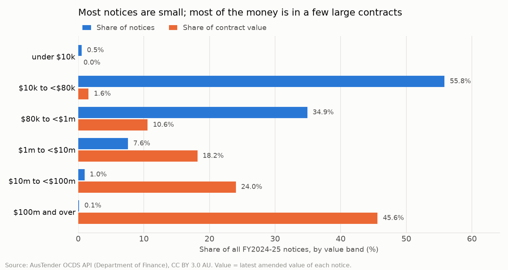
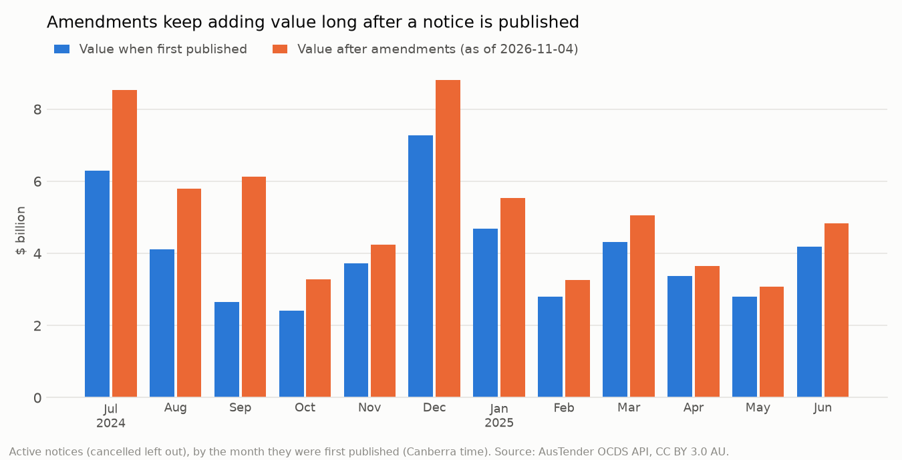

# Australian Government procurement spend analytics (AusTender)

> **Status: in progress (Part 1 of 5 done: source and profile).** The parts still to come are listed in the [roadmap](#roadmap).

The Australian Government publishes a notice for every contract worth $10,000 or more on
AusTender. That makes it one of the few places where you can see how a large organisation really
buys: from whom, for what, how competitively, and how far contracts grow after they're signed.

This project analyses **one financial year of contract notices (FY2024-25)** with Python and DuckDB
SQL. It asks the questions a procurement lead, a category manager or an audit committee would ask:

1. **Spend:** where does the money go, by agency, category and supplier?
2. **Concentration:** in which categories do a few suppliers hold most of the spend?
3. **Competition and compliance:** how much is bought without an open approach, why, and are
   notices published on time?
4. **Categorisation:** many notices are coded only to a broad category. Can an LLM-assisted
   categoriser (with an offline fallback) sort them into useful spend categories?

## Data

| | |
|---|---|
| Dataset | [AusTender OCDS API](https://github.com/austender/austender-ocds-api), `findByDates/contractPublished` |
| Publisher | Australian Government Department of Finance |
| Licence | [CC BY 3.0 AU](https://creativecommons.org/licenses/by/3.0/au/), stated in every API response. Contains AusTender data © Commonwealth of Australia. |
| Scope | Contract notices first published 1 Jul 2024 to 30 Jun 2025 (Canberra time), with every amendment published up to the download date |
| In this repo | `data/releases.csv.gz`: one row per notice version, flattened by `scripts/build_snapshot.py`. `data/SNAPSHOT.json` records the counts, download dates and SHA-256. |

No key or sign-up is needed. `scripts/download_data.py` asks the API for one Canberra day at a
time, follows its cursor pages and saves each day to `data/raw/` (not committed). Officer names,
email addresses, phone numbers and street addresses are left out of the snapshot; they aren't
needed for spend analysis.

Supplier names in the data include some sole traders. This project reports on agencies,
categories and the largest suppliers, all published by the government for transparency, and
doesn't single out individuals.

## Part 1: what the data can and can't tell us

Full results: [`results/SOURCE_PROFILE.md`](results/SOURCE_PROFILE.md) (generated; every figure comes
from the snapshot) and [`results/AMENDMENT_CHECK.md`](results/AMENDMENT_CHECK.md).

The snapshot holds **59,464 contract notices** first published in FY2024-25 and **22,513
amendments** to them, published up to 4 Nov 2026. Before asking what the government buys, this part
checks what the data means. Several plausible readings turn out to be wrong:

| Trap | What the data shows | Rule from here on |
|---|---|---|
| **Adding up every row** | An amendment's value is the contract's *new total*, not the change. The API doesn't say so; it was settled by matching two amendments of a Defence contract against the government's older bulk export, where the step between versions equals the published change to the cent. Summing every row gives $170.86bn, 2.6 times the $65.41bn from each notice's latest version. | One row per notice, its latest version. |
| **Sorting amendments as text** | Up to 36 amendments on one notice, and every amendment points back at the original notice rather than the one before it. As text, A10 sorts before A9. | Order by amendment number, as a number. |
| **Value at award = value now** | $51.86bn when first published, $65.41bn after amendments (26.1% more), and still rising: amendments to these notices were still being published in Nov 2026. | Say which value a figure uses; judge thresholds on the value at award. |
| **"57.3% limited tenders" as a red flag** | 25,140 of the 34,100 limited tenders (73.7%) were under $80k at award, where an open approach isn't required. | Judge limited tenders from $80k up, by their reason or exemption code. |
| **Grouping suppliers by name** | 2,956 of 13,026 supplier ABNs appear under more than one name (one under 52); those ABNs hold 58.3% of value. | Group by ABN (or the API's supplier id where there's no ABN). |
| **Counting cancelled notices** | 1,272 notices are cancelled ($3.20bn). Some come back under a new number, including a $2.34bn Home Affairs contract published twice, the first copy since cancelled. | Leave cancelled notices out of spend. |
| **Comparing fine-grained categories** | 57.4% of notices (60.3% of value) are coded only to a broad UNSPSC segment or family. | Compare at family level, or recategorise (Part 4). |



Other things worth knowing before building on this data:

- **The money is concentrated.** The top 1% of notices (595) hold 68.6% of value and the 84
  notices of $100m and over hold 45.6%, while 56.4% of notices are under $80k and hold 1.6%.
  Defence alone holds 41.8%. Every later result is shown with counts and medians as well as totals.
- **Amendment dates come in batches.** On the busiest day, 8 May 2025, 766 amendments were
  published, 95.0% from Defence, so an amendment's publish date isn't the date it was agreed.
- **The API carries less than the AusTender website.** There's no panel, consultancy or
  confidentiality flag, amendments almost never change the dates (so term extensions can't be
  seen), and agency branch and division sit on the supplier record next to the officer's
  contact details. The snapshot keeps branch and division and drops the personal details.
- **Late publication is common.** The rules ask for a notice within 42 days of the contract
  starting; 8,737 notices (14.7%) came later. Part 3 looks at which agencies, and whether some
  of it is backdated starts.



**So what for the business?** Anyone building a procurement dashboard straight from this feed
would overstate spend about 2.6 times, flag three in four limited tenders as a compliance
problem although they're under the $80k line where an open approach isn't required, and split major suppliers into dozens of names. The fixes are cheap (latest version only, ABN as
the supplier key, cancelled notices out, the $80k line), but they have to be decided before the
first chart, which is what this part does. Two questions stay open for the agencies themselves:
why so many contracts grow after award, and why one notice in seven is published late.

## Roadmap

- [x] **Part 1: source and profile.** Download, snapshot, the traps in the data and the rules they set.
- [ ] **Part 2: spend cube.** Category names for UNSPSC codes, spend by agency, category and supplier, and supplier concentration by category.
- [ ] **Part 3: competition and compliance.** Limited tenders from $80k by reason and agency, value clustering under thresholds, late publication, and contracts that grew most after award.
- [ ] **Part 4: LLM-assisted categoriser.** Sorting coarsely coded notices into spend categories from their descriptions, with an offline baseline, a Claude backend (needs a key) and a hand-labelled check set.
- [ ] **Part 5: write-up.** CI, TL;DR, ranked recommendations, limitations.

## How to run

```bash
python -m venv .venv && source .venv/bin/activate   # or: uv venv
pip install -r requirements-lock.txt

# Optional: rebuild the snapshot from the API (about 1,300 requests; ~15 minutes)
python -m scripts.download_data --fy 2024
python -m scripts.build_snapshot

python -m scripts.check_amendment_values   # live API cross-check (network)
python -m scripts.profile_releases         # Part 1 report and charts, offline
pytest
```

## Project structure

```
data/            releases.csv.gz (the snapshot), SNAPSHOT.json; raw/ is not committed
scripts/         download_data.py, build_snapshot.py, check_amendment_values.py, profile_releases.py
sql/             00_load.sql (typed views), profile.sql (Part 1 checks)
results/         SOURCE_PROFILE.md, AMENDMENT_CHECK.md, CSVs, charts/
tests/           unit tests on hand-written releases, plus checks on the committed snapshot
```
