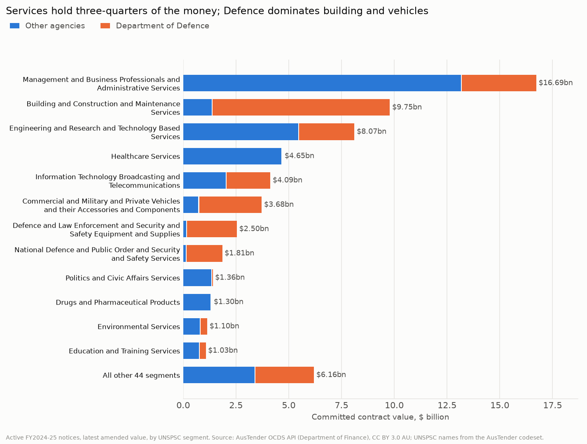
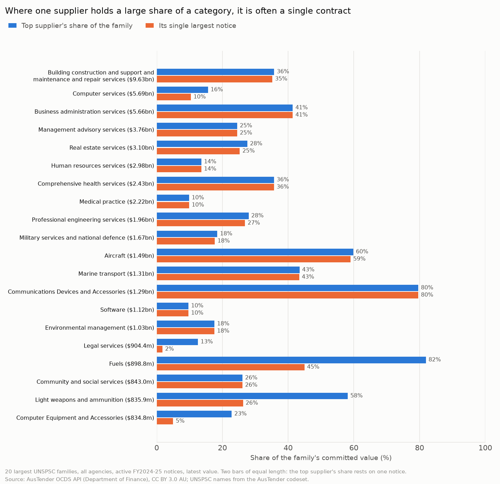
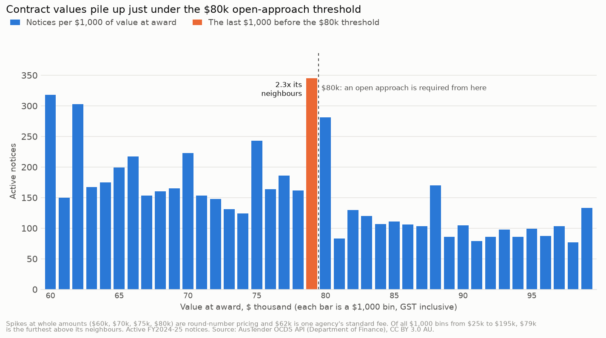
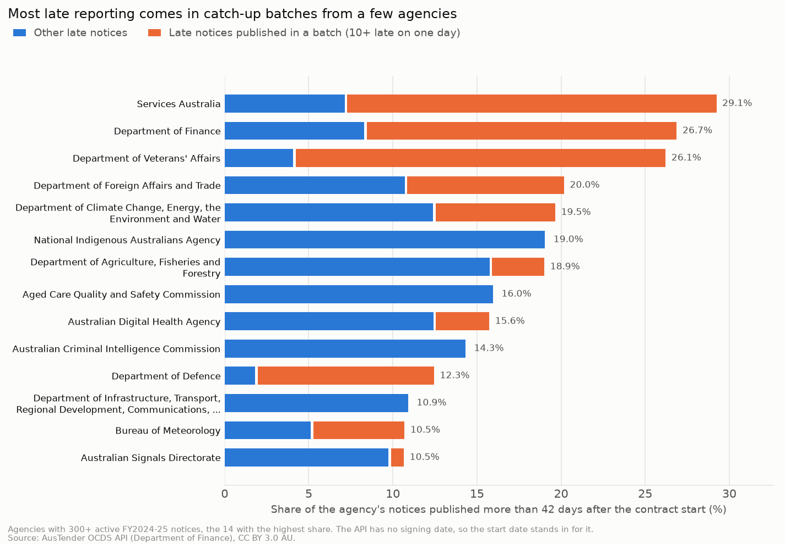

# Australian Government procurement spend analytics (AusTender)

> **Status: in progress (Parts 1 to 3 of 5 done: source profile, spend cube, competition and compliance).** The parts still to come are listed in the [roadmap](#roadmap).

The Australian Government publishes a notice for every contract worth $10,000 or more on
AusTender. That makes it one of the few places where you can see how a large organisation really
buys: from whom, for what, how competitively, and how far contracts grow after they're signed.

This project analyses **one financial year of contract notices (FY2024-25)** with Python and DuckDB
SQL. It asks the questions a procurement lead, a category manager or an audit committee would ask:

1. **Spend:** where does the money go, by agency, category and supplier?
2. **Concentration:** in which categories do a few suppliers hold most of the spend?
3. **Competition and compliance:** how much is bought without an open approach, why, and are
   notices published on time?
4. **Categorisation:** many notices are coded only to a broad category. Can an LLM-assisted
   categoriser (with an offline fallback) sort them into useful spend categories?

## Data

| | |
|---|---|
| Dataset | [AusTender OCDS API](https://github.com/austender/austender-ocds-api), `findByDates/contractPublished` |
| Publisher | Australian Government Department of Finance |
| Licence | [CC BY 3.0 AU](https://creativecommons.org/licenses/by/3.0/au/), stated in every API response. Contains AusTender data © Commonwealth of Australia. |
| Scope | Contract notices first published 1 Jul 2024 to 30 Jun 2025 (Canberra time), with every amendment published up to the download date |
| In this repo | `data/releases.csv.gz`: one row per notice version, flattened by `scripts/build_snapshot.py`. `data/SNAPSHOT.json` records the counts, download dates and SHA-256. |

No key or sign-up is needed. `scripts/download_data.py` asks the API for one Canberra day at a
time, follows its cursor pages and saves each day to `data/raw/` (not committed). Officer names,
email addresses, phone numbers and street addresses are left out of the snapshot; they aren't
needed for spend analysis.

Supplier names in the data include some sole traders. This project reports on agencies,
categories and the largest suppliers, all published by the government for transparency, and
doesn't single out individuals.

## Part 1: what the data can and can't tell us

Full results: [`results/SOURCE_PROFILE.md`](results/SOURCE_PROFILE.md) (generated; every figure comes
from the snapshot) and [`results/AMENDMENT_CHECK.md`](results/AMENDMENT_CHECK.md).

The snapshot holds **59,464 contract notices** first published in FY2024-25 and **22,513
amendments** to them, published up to 4 Nov 2026. Before asking what the government buys, this part
checks what the data means. Several plausible readings turn out to be wrong:

| Trap | What the data shows | Rule from here on |
|---|---|---|
| **Adding up every row** | An amendment's value is the contract's *new total*, not the change. The API doesn't say so; it was settled by matching two amendments of a Defence contract against the government's older bulk export, where the step between versions equals the published change to the cent. Summing every row gives $170.86bn, 2.6 times the $65.41bn from each notice's latest version. | One row per notice, its latest version. |
| **Sorting amendments as text** | Up to 36 amendments on one notice, and every amendment points back at the original notice rather than the one before it. As text, A10 sorts before A9. | Order by amendment number, as a number. |
| **Value at award = value now** | $51.86bn when first published, $65.41bn after amendments (26.1% more), and still rising: amendments to these notices were still being published in Nov 2026. | Say which value a figure uses; judge thresholds on the value at award. |
| **"57.3% limited tenders" as a red flag** | 25,140 of the 34,100 limited tenders (73.7%) were under $80k at award, where an open approach isn't required. | Judge limited tenders from $80k up, by their reason or exemption code. |
| **Grouping suppliers by name** | 2,956 of 13,026 supplier ABNs appear under more than one name (one under 52); those ABNs hold 58.3% of value. | Group by ABN (or the API's supplier id where there's no ABN). |
| **Counting cancelled notices** | 1,272 notices are cancelled ($3.20bn). Some come back under a new number, including a $2.34bn Home Affairs contract published twice, the first copy since cancelled. | Leave cancelled notices out of spend. |
| **Comparing fine-grained categories** | 57.4% of notices (60.3% of value) are coded only to a broad UNSPSC segment or family. | Compare at family level, or recategorise (Part 4). |


Other things worth knowing before building on this data:

- **The money is concentrated.** The top 1% of notices (595) hold 68.6% of value and the 84
  notices of $100m and over hold 45.6%, while 56.4% of notices are under $80k and hold 1.6%.
  Defence alone holds 41.8%. Every later result is shown with counts and medians as well as totals.
- **Amendment dates come in batches.** On the busiest day, 8 May 2025, 766 amendments were
  published, 95.0% from Defence, so an amendment's publish date isn't the date it was agreed.
- **The API carries less than the AusTender website.** There's no panel, consultancy or
  confidentiality flag, amendments almost never change the dates (so term extensions can't be
  seen), and agency branch and division sit on the supplier record next to the officer's
  contact details. The snapshot keeps branch and division and drops the personal details.
- **Late publication is common.** The rules ask for a contract to be reported within 42 days of
  entering into it. The API has no signing date, so the start date stands in:
  8,737 notices (14.7%) were published more than 42 days after it. Part 3 finds that half the late notices
  come in catch-up batches.


**So what for the business?** Anyone building a procurement dashboard straight from this feed
would overstate spend about 2.6 times, flag three in four limited tenders as a compliance
problem although they're under the $80k line where an open approach isn't required, and split major suppliers into dozens of names. The fixes are cheap (latest version only, ABN as
the supplier key, cancelled notices out, the $80k line), but they have to be decided before the
first chart, which is what this part does. Two questions stay open for the agencies themselves:
why so many contracts grow after award, and why one notice in seven is published late.

## Part 2: where the money goes, and who it goes to

Full results: [`results/SPEND_CUBE.md`](results/SPEND_CUBE.md) (generated), plus BI-ready CSVs in
[`results/`](results/): the agency × category cube, concentration by category, suppliers and agencies.

Category names come from the government's own **AusTender Customised UNSPSC Codeset** (data.gov.au,
CC BY 3.0 AU), which every one of the 537 codes on these notices matches. Following Part 1's rules,
this part counts the **58,192 active notices**, each at its latest value: **$62.21bn of committed
contract value** ($48.60bn at award). Committed value is what contracts are worth over their life,
not what was paid this year.

**Where it goes.** Services take 75.9% of the money. One segment, *Management and Business
Professionals and Administrative Services*, holds 26.8% on its own. Defence holds 43.5% of all
value and 86.1% of building and construction ($9.75bn), so every concentration result is shown with
and without Defence.



**Who it goes to.** 16,242 suppliers, but **58 of them hold half the committed value** and 391
hold 80%. At the other end, 10,103 suppliers (62.2%) won exactly one notice. Big totals are often
a single contract: Ventia, the largest supplier ($3.44bn), has 98.5% of it in one notice.

**Is any category dependent on one supplier?** For each of the 42 large categories (UNSPSC
families of $100m or more with at least 20 notices; 89.7% of value), the analysis measures the top
supplier's share and the Herfindahl-Hirschman Index (HHI). One year of notices is lumpy, so each
category is measured again **without its single largest notice**. That separates "one big
contract" from concentration that goes beyond it:

| Large categories, all agencies | Categories | Committed value |
|---|---:|---:|
| Low concentration (HHI under 1,500) | 25 | $31.41bn |
| Moderate (1,500 to 2,500) | 7 | $17.47bn |
| High, but only because of one contract | 4 | $2.73bn |
| High beyond one contract | 6 | $4.17bn |



Only $4.17bn (7.5% of large-category value) sits in categories concentrated beyond one contract.
They are fuels (one supplier, 81.9% from 28 notices), advertising (one supplier, 69.1% from 284
notices), insurance (Comcare, the government's workers' compensation insurer, 42.7%), light weapons
and ammunition, and two categories led by one Defence electronics supplier (CEA Technologies: 79.6%
and 62.7%). Without Defence, 11 of 29 large categories are highly concentrated,
6 of them because of one contract (e.g. a $2.34bn Home Affairs detention services contract, 60.6%
of non-Defence business administration).

**The opposite pattern is bigger.** 12 large categories worth $19.11bn are bought by 20 or more
agencies from a long tail of suppliers, where it takes 30 or more suppliers to reach 80% of the
value. Human resources services (labour hire): 108 agencies, 962 suppliers, 138 needed for 80%.
Computer services: 112 agencies, 1,517 suppliers.

**So what for the business?** For a procurement lead, the headline isn't supplier dependence.
The concentrated categories are few, small and mostly explainable (one large contract, a statutory
insurer, or what looks like a central arrangement), so the job there is to confirm each one is
deliberate and to manage the big contracts well. The larger lever is fragmentation: $19.11bn of
common services, such as labour hire and IT, bought separately by dozens of agencies from hundreds of
suppliers. That is where pooled demand and whole-of-government panels pay off. The API has no
panel flag, so the first step is to check how much of it already goes through panels. Two more
lessons for anyone building a spend dashboard: measure concentration with and without the largest
contract, or one award will look like a monopoly; and keep the 4,672 segment-only notices ($2.39bn)
visible rather than dropping them, since Part 4 tries to place them.

## Part 3: competition and compliance

Full results: [`results/COMPLIANCE.md`](results/COMPLIANCE.md) (generated), plus review lists in
[`results/`](results/): limited tenders and late publication by agency, and the 200 contracts that grew most.

The rules are the Commonwealth Procurement Rules of 1 July 2024. From $80k (GST inclusive; $400k
for prescribed corporate entities, $7.5m for construction) an agency has to approach the open market
unless a paragraph 10.3 condition or an Appendix A exemption applies, and every contract of $10k or more has
to be reported within 42 days of entering into it. The API has no expected value, signing date or entity
type, so the value at award, the contract start date and the $80k line stand in for them. The same
58,192 active notices as Part 2.

**Limited tenders almost always give a reason.** 8,687 of the 23,860 notices worth $80k or more at
award (36.4%) were limited tenders, holding 39.4% of that value; without Defence, 26.2% and 25.0%.
4,755 cite a 10.3 condition and 3,878 an exemption. Only 54 give neither, and all 54 have since been
amended below $80k, which looks like a value keyed wrongly at award. The biggest routes are Defence's
own exemption (`AM`, $6.63bn at award, 95.3% Defence), then extensions with the original supplier
(`AD`) and sole sources for technical reasons (`TR`): 3,792 notices and $5.80bn together.

**Values pile up just under $80k.** The last $1,000 before the threshold holds 345 notices, 2.31
times the mean of its neighbouring bins. At the other 13 round amounts from $30k to $160k the ratio
is 0.82 to 1.52, and of all 170 $1,000 bins from $25k to $195k (leaving out whole-thousand values),
the one under $80k is furthest above its neighbours. That is about 196 more notices than expected.
But the extra notices aren't more often limited tenders (59.7% against 61.3% next to them), so the
data doesn't show the threshold being dodged to avoid competition. Budgets and approval limits set at
$80k would give the same pattern.



A check for split purchases (limited tenders under $80k to one supplier, same description and start,
published within 30 days, $80k or more together) finds 220 groups: 710 notices and $32.9m at award at
15 agencies. Most will have ordinary explanations, so it's a sample list for internal audit, not a finding.

**Late reporting is mostly a few catch-up batches.** 8,390 notices (14.4%, $9.55bn) were published
more than 42 days after the contract started. 51.6% of them came out on 166 days when one agency
published 10 or more late notices. The largest: on 2024-09-16, Services Australia published 363 late
notices, 360 of them agent and access point agreements starting 2024-07-01; Veterans' Affairs
published its 1 July hospital, day procedure and community nursing agreements in December; Finance
reported 88 electorate office leases that started between 2004 and 2022 in one day. Defence has the
most late notices (2,560), but outside its batches only 1.8% of its notices are late.



**Value at award understates what's committed.** Active notices grew from $48.60bn at award to
$62.21bn (28.0%), and open tenders grow more often than limited ones: 43.0% of open tenders from $80k
grew, against 14.9% of limited tenders under a 10.3 condition and 23.1% under an exemption. The
outliers are the ones to explain. Contracts let for extreme urgency (`EU`) grew 413.1%, mostly through one
Defence construction contract (CN4104389) that went from $2.1m to $314.8m. 308 Veterans' Affairs notices
were published at exactly $10,000, the reporting threshold, and later amended to $1.23bn. In all,
1,814 notices that were under $80k at award are now $80k or more.

**So what for the business?** The compliance basics hold up: above the line, almost every limited
tender cites an allowed reason, so the work is checking that the reason fits, starting with the $5.80bn
of extensions and sole sources, where the most money rides on whether the market was tested. Bunching under $80k is
real but small and not tied to avoiding competition. It points to budgets or delegations set at the
threshold, which is worth a look now that the line has moved to $125k (from 17 Nov 2025). Late
reporting is mostly a process problem: half of all late notices come in catch-up batches, and the
largest batches are annual agreements that start on 1 July and are signed or reported months
later. Moving those renewals earlier in a few agencies is the biggest single fix. And because award values can be placeholders, a transparency
dashboard should track current value and flag contracts that grew past a threshold or more than
tenfold, not just the value at award.

## Roadmap

- [x] **Part 1: source and profile.** Download, snapshot, the traps in the data and the rules they set.
- [x] **Part 2: spend cube.** Category names from the AusTender UNSPSC codeset, spend by agency, category and supplier, supplier concentration by category (with and without Defence, and without the largest contract), and a BI-ready cube.
- [x] **Part 3: competition and compliance.** Limited tenders from $80k by reason and agency, value bunching under thresholds, possible split purchases, late publication and catch-up batches, and growth after award.
- [ ] **Part 4: LLM-assisted categoriser.** Sorting coarsely coded notices into spend categories from their descriptions, with an offline baseline, a Claude backend (needs a key) and a hand-labelled check set.
- [ ] **Part 5: write-up.** CI, TL;DR, ranked recommendations, limitations.

## How to run

```bash
python -m venv .venv && source .venv/bin/activate   # or: uv venv
pip install -r requirements-lock.txt

# Optional: rebuild the snapshot from the API (about 1,300 requests; ~15 minutes)
python -m scripts.download_data --fy 2024
python -m scripts.build_snapshot

python -m scripts.check_amendment_values   # live API cross-check (network)
python -m scripts.profile_releases         # Part 1 report and charts, offline
python -m scripts.build_categories         # optional: rebuild the UNSPSC lookup (downloads 80 KB)
python -m scripts.spend_cube               # Part 2 report, charts and CSVs, offline
python -m scripts.compliance               # Part 3 report, charts and CSVs, offline
pytest
```

## Project structure

```
data/            releases.csv.gz (the snapshot), SNAPSHOT.json, unspsc_categories.csv; raw/ is not committed
scripts/         download_data.py, build_snapshot.py, check_amendment_values.py, profile_releases.py,
                 build_categories.py, spend_cube.py, compliance.py
sql/             00_load.sql (typed views), profile.sql (Part 1), 01_spend.sql + spend.sql (Part 2),
                 02_compliance.sql + compliance.sql (Part 3)
results/         SOURCE_PROFILE.md, AMENDMENT_CHECK.md, SPEND_CUBE.md, COMPLIANCE.md, CSVs, charts/
tests/           unit tests on hand-written releases, plus checks on the committed snapshot
```
