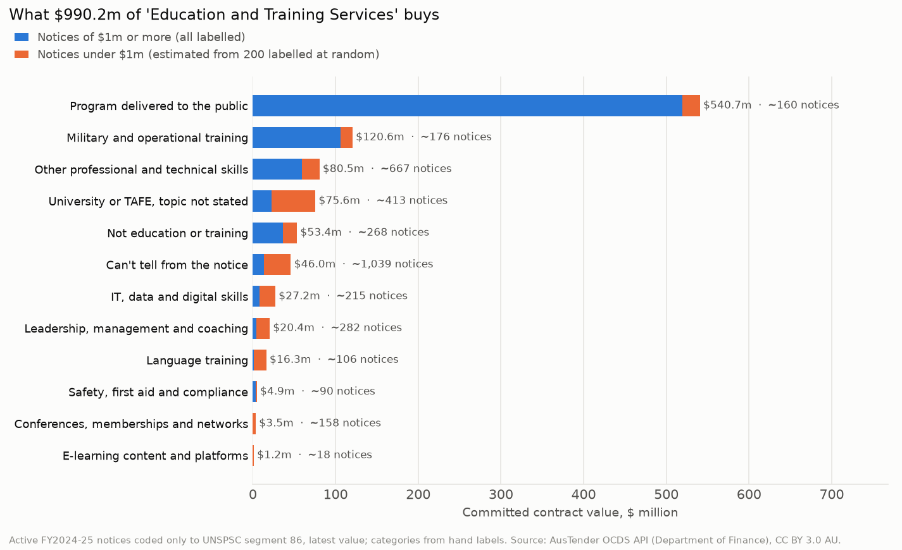
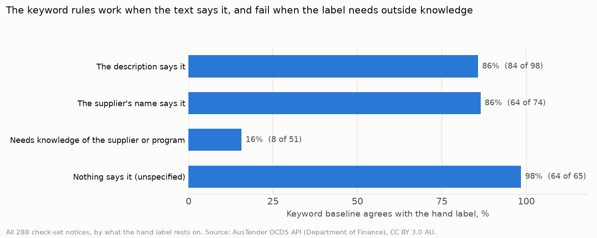

# Part 4: what 'Education and Training' spend buys, and can a categoriser tell?

Generated by `python -m scripts.categorise` from the snapshot (amendments to 2026-11-04) and the hand-labelled check set in `data/check_set/`. Active notices, latest value, as in Parts 2 and 3.

## 1. Which notices need a category

4,672 active notices ($2.39bn) are coded only to a UNSPSC segment. For most of them, the AusTender codeset offers nothing finer: an agency buying training can only pick *Education and Training Services*.

| Segment | Title | Notices | Value | Family codes in the codeset | All finer codes | Vaccine notices | Vaccine value |
|---|---|---|---|---|---|---|---|
| 86 | Education and Training Services | 3,589 | $990.2m | 0 | 2 | 0 | $0 |
| 50 | Food and Beverage Products | 505 | $29.9m | 8 | 9 | 0 | $0 |
| 42 | Medical Equipment and Accessories and Supplies | 294 | $34.1m | 10 | 11 | 1 | $19k |
| 27 | Tools and General Machinery | 170 | $10.4m | 0 | 0 | 0 | $0 |
| 51 | Drugs and Pharmaceutical Products | 37 | $1.30bn | 0 | 0 | 7 | $1.30bn |
| 46 | Defence and Law Enforcement and Security and Safety Equipment and Supplies | 36 | $25.7m | 10 | 24 | 0 | $0 |
| 23 | Industrial Manufacturing and Processing Machinery and Accessories | 28 | $1.8m | 12 | 12 | 0 | $0 |
| 48 | Service Industry Machinery and Equipment and Supplies | 13 | $2.2m | 2 | 2 | 0 | $0 |

- Segments with no family-level code (86, 27, 51; segment 86 has only two narrow commodity codes, for vocational rehabilitation and library services): **3,796 notices, $2.30bn** (81.2% of segment-only notices). These aren't lazy coding; the codeset leaves no choice.
- Drugs and pharmaceuticals is $1.30bn, but 7 vaccine notices ($1.30bn) are 99.8% of it, and their descriptions already say what they are.
- Segments where agencies could have picked a family: 876 notices, $93.7m.
- **Education and Training is where a categoriser earns its keep:** 3,589 notices, $990.2m, with descriptions such as 'Training Services'. Part 4 sorts these.

## 2. The check set

The taxonomy (`scripts/training_taxonomy.py`) has 12 categories, in five groups, chosen for what a category manager would do with the spend. All 88 notices of $1m or more were labelled (a census, 78.2% of the value), plus 200 drawn at random from the 3,501 under $1m (seed 2025). One annotator labelled every row from the description, supplier and agency only, following `data/check_set/LABELLING_GUIDE.md`, and the labels were committed before the keyword rules were written.

| What the label rests on | $1m+ notices | Random sample |
|---|---|---|
| The description says it | 44 | 54 |
| The supplier's name says it | 16 | 58 |
| Needs knowledge of the supplier or program | 22 | 29 |
| Nothing says it (unspecified) | 6 | 59 |

51 of 288 labels (17.7%) needed knowledge that isn't in the notice: what SANS, Cubic, QinetiQ or Jeff Whalan Learning sell, or that *Be Connected* is a program for older Australians. No keyword rule can supply that.

## 3. What the money buys (from the hand labels)

Notices of $1m or more are exact. Under $1m, the random sample's shares (by count and by value) are applied to that stratum's real totals, so those figures are estimates: for example, the share of small notices whose topic is unknown is 41.0% in the sample (95% interval 34.4% to 47.9%).

| Group | Notices (est.) | Share of notices | Value (est.) | Share of value | Of which $1m+ (exact) |
|---|---|---|---|---|---|
| Program delivery, not staff training | 160 | 4.4% | $540.7m | 54.6% | $519.8m |
| Military and operational | 176 | 4.9% | $120.6m | 12.2% | $106.3m |
| Staff development, topic known | 1,535 | 42.8% | $154.0m | 15.6% | $75.9m |
| Topic unknown | 1,451 | 40.4% | $121.6m | 12.3% | $35.7m |
| Not training (miscoded) | 268 | 7.5% | $53.4m | 5.4% | $36.5m |

| Category | Group | $1m+ notices | In random sample | Notices (est.) | Value (est.) | Share of value |
|---|---|---|---|---|---|---|
| Program delivered to the public | Program delivery, not staff training | 37 | 7 | 160 | $540.7m | 54.6% |
| Military and operational training | Military and operational | 18 | 9 | 176 | $120.6m | 12.2% |
| Other professional and technical skills | Staff development, topic known | 2 | 38 | 667 | $80.5m | 8.1% |
| University or TAFE, topic not stated | Topic unknown | 10 | 23 | 413 | $75.6m | 7.6% |
| Not education or training | Not training (miscoded) | 5 | 15 | 268 | $53.4m | 5.4% |
| Can't tell from the notice | Topic unknown | 6 | 59 | 1,039 | $46.0m | 4.6% |
| IT, data and digital skills | Staff development, topic known | 5 | 12 | 215 | $27.2m | 2.7% |
| Leadership, management and coaching | Staff development, topic known | 2 | 16 | 282 | $20.4m | 2.1% |
| Language training | Staff development, topic known | 1 | 6 | 106 | $16.3m | 1.6% |
| Safety, first aid and compliance | Staff development, topic known | 2 | 5 | 90 | $4.9m | 0.5% |
| Conferences, memberships and networks | Staff development, topic known | 0 | 9 | 158 | $3.5m | 0.4% |
| E-learning content and platforms | Staff development, topic known | 0 | 1 | 18 | $1.2m | 0.1% |

- **Over half the value isn't training staff at all.** Programs delivered to the public are $540.7m (54.6%) in about 160 notices. The Skills for Education and Employment program alone is 18 notices and $428.3m.
- **Military and operational training** is $120.6m (12.2%), 88% of it in notices of $1m or more. The largest is training bought through what appears to be the US Foreign Military Sales account ($41.7m, 2 notices); most of the rest is training systems (such as the P-8A's) and defence simulation and training firms such as Cubic, QinetiQ, Saab and Kongsberg.
- **Staff development with a known topic** is about $154.0m in about 1,535 notices (42.8% of notices): professional and technical skills, IT and data, leadership and coaching, languages, safety, memberships.
- **A further $121.6m, in about 1,451 notices (40.4%), can't be placed at all:** the notice says only something like 'Training Services' and the supplier's name doesn't say what the training is (a university or TAFE, or an unknown firm). Together with the known topics, that puts agencies' own staff development here at $275.6m at most.
- **Not training:** about $53.4m (268 notices) is catering, venues, school fees, care services, quality assurance, consulting, internships and similar, coded as education.

## 4. How well the keyword baseline does

`scripts/categorise.py` applies ordered keyword rules to the description and supplier name. It records the rule that fired, so every label can be explained. It was scored once against the check set; the rules weren't changed after seeing the score.

| Check set | Notices | Agrees with hand label | Accuracy | Accuracy by value |
|---|---|---|---|---|
| Random sample (typical notice) | 200 | 155 | 77.5% | 77.2% |
| $1m+ notices (the money) | 88 | 65 | 73.9% | 87.0% |

| What the label rests on | Notices | Baseline agrees | Accuracy |
|---|---|---|---|
| The description says it | 98 | 84 | 85.7% |
| The supplier's name says it | 74 | 64 | 86.5% |
| Needs knowledge of the supplier or program | 51 | 8 | 15.7% |
| Nothing says it (unspecified) | 65 | 64 | 98.5% |

Where the notice's own words say the category, the rules agree with the hand label 148 times out of 172 (86.0%). Where the label needs outside knowledge, 8 of 51. Of the 68 disagreements, 56 are the rules saying 'unspecified' where the hand label has a category; only 12 put a notice in a different category. So the baseline is cautious rather than wrong:

| Category | Hand labels | Baseline labels | Both agree | Precision | Recall |
|---|---|---|---|---|---|
| Program delivered to the public | 44 | 35 | 35 | 100.0% | 79.5% |
| Not education or training | 20 | 14 | 14 | 100.0% | 70.0% |
| Military and operational training | 27 | 17 | 17 | 100.0% | 63.0% |
| Leadership, management and coaching | 18 | 19 | 17 | 89.5% | 94.4% |
| Language training | 7 | 7 | 7 | 100.0% | 100.0% |
| IT, data and digital skills | 17 | 8 | 5 | 62.5% | 29.4% |
| Safety, first aid and compliance | 7 | 3 | 3 | 100.0% | 42.9% |
| Other professional and technical skills | 40 | 27 | 23 | 85.2% | 57.5% |
| E-learning content and platforms | 1 | 2 | 1 | 50.0% | 100.0% |
| Conferences, memberships and networks | 9 | 4 | 4 | 100.0% | 44.4% |
| University or TAFE, topic not stated | 33 | 32 | 30 | 93.8% | 90.9% |
| Can't tell from the notice | 65 | 120 | 64 | 53.3% | 98.5% |

For 9 of the 11 named categories, at least 85% of the baseline's labels agree with the hand label. When the rules name a category, the label can usually be trusted; the work is in what they leave as 'unspecified'.

Most common disagreements:

| Hand label | Baseline label | Notices |
|---|---|---|
| Other professional and technical skills | Can't tell from the notice | 15 |
| IT, data and digital skills | Can't tell from the notice | 12 |
| Military and operational training | Can't tell from the notice | 7 |
| Program delivered to the public | Can't tell from the notice | 5 |
| Not education or training | Can't tell from the notice | 5 |
| Safety, first aid and compliance | Can't tell from the notice | 4 |
| Conferences, memberships and networks | Can't tell from the notice | 4 |
| University or TAFE, topic not stated | Can't tell from the notice | 3 |

## 5. The baseline on every notice

Run on all notices, the baseline leaves 2,047 notices ($178.5m) as 'unspecified', against about 1,039 ($46.0m) in the hand-label estimate: 2.0 times by count and 3.9 times by value, because it can't use what suppliers are known for. Use its labels for the categories it names; treat its 'unspecified' as an upper bound.

| Category | Baseline notices | Baseline value | Hand-label estimate, notices | Hand-label estimate, value |
|---|---|---|---|---|
| Program delivered to the public | 78 | $513.7m | 160 | $540.7m |
| Not education or training | 65 | $34.6m | 268 | $53.4m |
| Military and operational training | 149 | $52.7m | 176 | $120.6m |
| Leadership, management and coaching | 224 | $15.1m | 282 | $20.4m |
| Language training | 118 | $12.3m | 106 | $16.3m |
| IT, data and digital skills | 70 | $8.3m | 215 | $27.2m |
| Safety, first aid and compliance | 58 | $6.8m | 90 | $4.9m |
| Other professional and technical skills | 233 | $113.7m | 667 | $80.5m |
| E-learning content and platforms | 32 | $4.1m | 18 | $1.2m |
| Conferences, memberships and networks | 100 | $2.0m | 158 | $3.5m |
| University or TAFE, topic not stated | 415 | $48.3m | 413 | $75.6m |
| Can't tell from the notice | 2,047 | $178.5m | 1,039 | $46.0m |

## 6. The Claude backend

**Not run: no `ANTHROPIC_API_KEY`.** The backend is built and tested with a fake client (`tests/test_categorise.py`): the same taxonomy and decision order as a prompt, a forced tool call with the category as an enum, batches of 40, and any missing or invalid answer falls back to the baseline label and is counted. One run over all 3,589 notices is about 90 calls, ~233k input and ~71k output tokens (model `claude-haiku-5-5` by default; set `CLAUDE_MODEL` to change it). The check set shows where it could help: the 51 labels that rest on outside knowledge, where the baseline gets 8 right.
