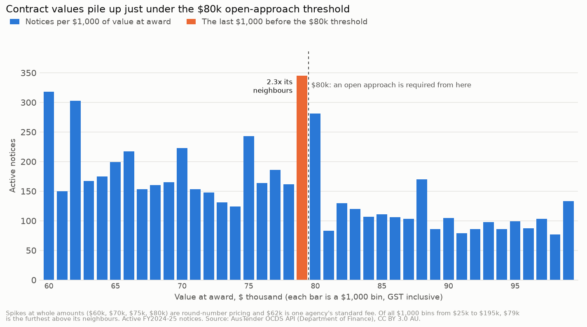
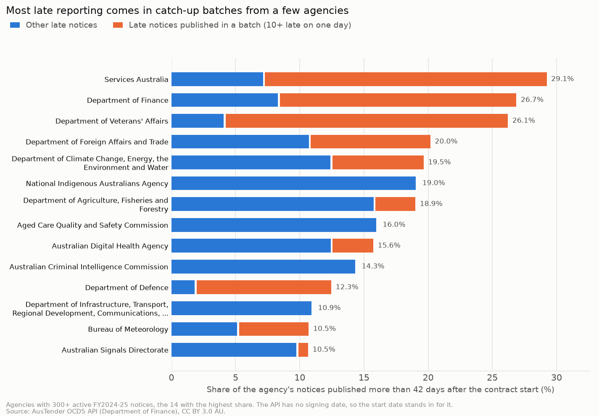

# Competition and compliance

Generated by `scripts/compliance.py` from `sql/02_compliance.sql` and `sql/compliance.sql`. Every
number below is computed from `data/releases.csv.gz`.

## Scope and rules

| | |
|---|---|
| Notices | 58,192 active notices first published in FY2024-25, as in Part 2 |
| Rules | The Commonwealth Procurement Rules (CPRs) of 1 July 2024, in force for the whole year. From $80,000 (non-corporate entities; $400,000 for prescribed corporate entities, $7.5 million for construction), GST inclusive, an open approach is needed unless a paragraph 10.3 condition or an Appendix A exemption applies. The $80,000 line rose to $125,000 on 17 November 2025, after this year. |
| Threshold value | The CPRs judge the threshold on the *expected* value. The API doesn't carry it, so the value at award (each notice's first version) stands in for it. |
| Entity type | The API doesn't say which agencies are corporate entities, so the $80,000 line is applied to all of them. For a corporate entity it may be the wrong line. |
| Late publication | The CPRs ask for a contract to be reported within 42 days of entering into it. The API has no signing date (its `dateSigned` is the publish date), so the lag is measured from the contract start date. A contract signed after it started looks late here even if it was reported on time. All 58,192 active notices have a usable start date (the 1900 placeholders are all on cancelled notices). |
| Values | Thresholds use the value at award; spend and growth use the latest value as of 2026-11-04. |

## 1. Limited tenders from $80k

23,860 active notices were worth $80k or more at award ($47.53bn). 8,687 of them (36.4%) were limited tenders, $18.73bn at award (39.4% of the value). Without Defence: 4,453 of 17,017 (26.2%), 25.0% of the value. Below $80k, 24,581 of 34,332 notices are limited tenders, which the rules allow.

| route | notices | notice_share | award_value | award_value_share | current_value | notices_ex_defence | award_value_ex_defence |
|---|---|---|---|---|---|---|---|
| 1. Open tender | 15,159 | 63.5% | $28.76bn | 60.5% | $37.46bn | 12,550 | $20.58bn |
| 2. Prequalified tender | 14 | 0.1% | $43.2m | 0.1% | $56.8m | 14 | $43.2m |
| 3. Limited: a 10.3 condition | 4,755 | 19.9% | $6.82bn | 14.3% | $7.52bn | 1,814 | $2.63bn |
| 4. Limited: an exemption | 3,878 | 16.3% | $11.89bn | 25.0% | $14.65bn | 2,621 | $4.24bn |
| 5. Limited: no reason or exemption code | 54 | 0.2% | $22.4m | 0.0% | $2.2m | 18 | $11.4m |

- Almost every limited tender from $80k gives a reason: 4,755 a 10.3 condition and 3,878 an exemption. **54 give neither** ($22.4m at award). All 54 have since been amended below $80k ($2.2m in total now): probably a value keyed wrongly at award, not a missing reason.
- 61.9% of Defence's notices from $80k are limited tenders (59.2% of the value); its largest code is `AM` (paragraph 2.6 applied in part).

By condition or exemption (limited tenders from $80k, value at award):

| kind | code | meaning | notices | award_value | current_value | agencies | defence_share |
|---|---|---|---|---|---|---|---|
| exemption | AM | Paragraph 2.6 was applied in some part. | 862 | $6.63bn | $8.43bn | 12 | 95.3% |
| 10.3 condition | AD | 10.3.e. Additional deliveries by original supplier intended as replacement parts, extensions, or continuation for existing goods or services for compatibility. | 1,882 | $4.01bn | $4.26bn | 74 | 59.3% |
| 10.3 condition | TR | 10.3.d.iii. Supply by particular business: due to an absence of competition for technical reasons. | 1,910 | $1.79bn | $2.02bn | 75 | 62.2% |
| exemption | LP | App A: 1. Leasing of immovable property or any associated rights. | 444 | $1.74bn | $1.99bn | 39 | 3.3% |
| exemption | GE | App A: 2. From another Commonwealth, state, territory or local government entity. | 476 | $1.37bn | $1.65bn | 62 | 7.1% |
| exemption | DI | App A: 13. By, or on behalf of select Defence intelligence agencies. | 268 | $624.8m | $667.1m | 3 | 70.0% |
| exemption | IS | App A: 16. SME with at least 50 percent Indigenous ownership. | 317 | $592.5m | $829.2m | 41 | 82.8% |
| 10.3 condition | ER | 10.3.d.ii. Supply by particular business: with no reasonable alternative or substitute: to protect exclusive rights or proprietary information. | 371 | $391.4m | $413.9m | 43 | 69.8% |
| exemption | RD | App A: 6. Research and development services (but not inputs). | 274 | $307.8m | $315.1m | 32 | 15.9% |
| exemption | OA | App A: 8. Procuring outside Australian territory for consumption outside Australian territory. | 422 | $284.6m | $321.7m | 13 | 19.9% |
| 10.3 condition | VM | 10.3.a.i. No submissions or value for money submissions received. | 79 | $257.7m | $72.0m | 25 | 93.7% |
| exemption | FA | App A: 5. Direct purpose of providing foreign assistance. | 103 | $140.9m | $155.3m | 9 | 70.4% |
| 10.3 condition | PT | 10.3.g. Prototype intended for limited trial or developed at the entity's request for a research, experiment, study, or original development contract. | 67 | $80.8m | $86.5m | 8 | 89.4% |
| 10.3 condition | EU | 10.3.b. Extreme urgency or events unforeseen. | 94 | $78.7m | $403.7m | 22 | 55.7% |
| 10.3 condition | CT | Valued below the construction threshold. | 87 | $71.8m | $95.7m | 22 | 21.9% |

The two largest 10.3 conditions are `AD` (additional deliveries from the original supplier, $4.01bn) and `TR` (only one supplier for technical reasons, $1.79bn): extensions and sole sources, 3,792 notices and $5.80bn together. `EU` (extreme urgency) is small at award ($78.7m) but grew to $403.7m; see section 4.

Agencies with at least 100 notices from $80k, by the share of that value bought by limited tender:

| agency | notices_80k | award_value_80k | limited | limited_share | limited_value_share | by_condition | by_exemption | no_code | top_code | top_code_share |
|---|---|---|---|---|---|---|---|---|---|---|
| Australian Prudential Regulation Authority | 105 | $111.1m | 39 | 37.1% | 78.7% | 22 | 17 | 0 | LP | 85.6% |
| Department of Education | 155 | $151.4m | 43 | 27.7% | 63.1% | 23 | 20 | 0 | TR | 76.0% |
| Attorney-General's Department | 109 | $119.8m | 29 | 26.6% | 62.1% | 17 | 12 | 0 | LP | 90.7% |
| Department of Defence | 6,843 | $20.03bn | 4,234 | 61.9% | 59.2% | 2,941 | 1,257 | 36 | AM | 53.4% |
| Grains Research and Development Corporation | 184 | $305.5m | 81 | 44.0% | 58.5% | 30 | 51 | 0 | RD | 85.9% |
| Department of Infrastructure, Transport, Regional Development, Communications, Sport and the Arts | 406 | $411.4m | 167 | 41.1% | 50.1% | 110 | 56 | 1 | LP | 64.0% |
| Australian Signals Directorate | 696 | $643.4m | 298 | 42.8% | 48.1% | 69 | 226 | 3 | DI | 60.3% |
| Geoscience Australia | 140 | $85.0m | 65 | 46.4% | 47.3% | 28 | 37 | 0 | AD | 45.3% |
| CSIRO | 205 | $258.7m | 114 | 55.6% | 41.1% | 62 | 52 | 0 | GE | 30.5% |
| Australian Federal Police | 352 | $367.9m | 167 | 47.4% | 40.5% | 92 | 74 | 1 | OA | 36.6% |
| Services Australia | 1,132 | $1.65bn | 136 | 12.0% | 39.2% | 68 | 67 | 1 | LP | 68.8% |
| Department of Foreign Affairs and Trade | 1,136 | $2.81bn | 378 | 33.3% | 37.4% | 74 | 303 | 1 | GE | 59.4% |
| Australian Taxation Office | 314 | $1.32bn | 100 | 31.8% | 36.4% | 50 | 50 | 0 | AD | 61.9% |
| Australian Digital Health Agency | 443 | $192.4m | 57 | 12.9% | 33.8% | 33 | 24 | 0 | AD | 76.0% |
| Department of Finance | 508 | $761.0m | 293 | 57.7% | 33.8% | 44 | 249 | 0 | LP | 70.0% |

A high share isn't a breach: leases (`LP`), research and development (`RD`), buying from other governments (`GE`) and Defence's own exemptions (`AM`, `DI`) are all allowed routes. The question for each agency is whether its main code fits what it buys.

## 2. Bunching under the $80k threshold

If contracts are shaped to stay under a threshold, values pile up just below it. The test: notices in the last $1,000 before an amount, against the mean of the 8 neighbouring $1,000 bins. The bin that starts at the amount is left out, because whole amounts like $80,000.00 pile up there anyway.

| amount | is_threshold | last_1k | neighbour_mean | ratio | ratio_not_round | last_1k_limited_share | neighbour_limited_share |
|---|---|---|---|---|---|---|---|
| 30000 | False | 531 | 475.1 | 1.12 | 1.22 | 75.1% | 75.7% |
| 40000 | False | 335 | 297.3 | 1.13 | 1.24 | 67.2% | 70.0% |
| 50000 | False | 281 | 216.8 | 1.3 | 1.39 | 64.1% | 67.8% |
| 60000 | False | 182 | 213.0 | 0.85 | 0.98 | 59.3% | 67.0% |
| 70000 | False | 165 | 160.6 | 1.03 | 1.16 | 61.2% | 63.7% |
| 80000 | True | 345 | 149.4 | 2.31 | 2.54 | 59.7% | 61.3% |
| 90000 | False | 86 | 104.9 | 0.82 | 0.93 | 54.7% | 50.5% |
| 100000 | False | 133 | 87.4 | 1.52 | 1.08 | 48.1% | 50.6% |
| 110000 | False | 75 | 72.3 | 1.04 | 1.05 | 50.7% | 46.5% |
| 120000 | False | 62 | 67.8 | 0.92 | 0.95 | 32.3% | 51.8% |
| 130000 | False | 62 | 64.3 | 0.96 | 1.08 | 48.4% | 44.4% |
| 140000 | False | 69 | 58.0 | 1.19 | 1.27 | 39.1% | 46.1% |
| 150000 | False | 59 | 57.6 | 1.02 | 1.09 | 39.0% | 42.1% |
| 160000 | False | 55 | 46.8 | 1.18 | 1.24 | 40.0% | 40.1% |

- **At $80k the last $1,000 holds 345 notices, 2.31 times its neighbours** (2.54 without whole-thousand values). At the other 13 round amounts the ratio is 0.82 to 1.52. That is about 196 more notices than the neighbours would suggest.
- **Not just round amounts:** across all 170 $1,000 bins from $25k to $195k, leaving out whole-thousand values (they fill every bin that starts at a round amount), the $79k bin is the furthest above its neighbours (2.54). The next, $62k (1.85), is lifted by one exact value repeated 123 times, a standard fee.
- The extra notices aren't more often limited tenders: 59.7% of the last $1,000 against 61.3% of its neighbours. 139 of the 345 are open tenders (which can include orders from a panel set up by open tender). So the data doesn't show bunching being used to skip competition; budgets and approval limits set at the threshold would give the same pattern.
- 42 notices are exactly $79,200 ($72,000 plus GST). 191 are exactly $80,000; 149 of those are limited tenders, and 147 of them give a reason or exemption, as they should at the threshold.

The 8 bins furthest above their neighbours, on values that aren't whole thousands:

| bin | notices | neighbour_mean | ratio | ratio_not_round | same_value_max |
|---|---|---|---|---|---|
| 79000 | 345 | 149.4 | 2.31 | 2.54 | 42 |
| 62000 | 303 | 197.4 | 1.54 | 1.85 | 123 |
| 148000 | 74 | 66.1 | 1.12 | 1.4 | 13 |
| 49000 | 281 | 216.8 | 1.3 | 1.39 | 45 |
| 192000 | 59 | 45.3 | 1.3 | 1.39 | 21 |
| 115000 | 104 | 69.6 | 1.49 | 1.31 | 22 |
| 179000 | 52 | 46.0 | 1.13 | 1.28 | 9 |
| 78000 | 162 | 166.4 | 0.97 | 1.27 | 10 |

Other thresholds and policy amounts, with bins of 1.25% of the amount:

| amount | what | last_bin | neighbour_mean | ratio |
|---|---|---|---|---|
| 80000 | non-corporate entities | 345 | 149.4 | 2.31 |
| 88000 | $80k plus GST | 119 | 110.9 | 1.07 |
| 200000 | round amount | 159 | 104.1 | 1.53 |
| 400000 | prescribed corporate entities | 176 | 151.8 | 1.16 |
| 500000 | SME exemption ceiling (App A 17) | 121 | 75.4 | 1.61 |
| 1000000 | round amount | 47 | 34.1 | 1.38 |
| 7500000 | construction services | 10 | 5.5 | 1.82 |

None reaches the $80k ratio. $88,000 ($80k plus GST) shows no second pile (1.07), so there's no sign of agencies applying the threshold before GST. The $7.5m construction line (1.82) rests on 10 notices, too few to judge.

Agencies with at least 8 notices in the last $1,000 before $80k, against their own neighbouring bins (`same_value_max`: most notices sharing one exact value):

| agency | last_1k | neighbour_mean | same_value_max |
|---|---|---|---|
| Department of Defence | 81 | 49.0 | 11 |
| Services Australia | 25 | 2.1 | 21 |
| Department of Climate Change, Energy, the Environment and Water | 20 | 6.5 | 4 |
| Department of Health, Disability and Ageing | 15 | 5.6 | 3 |
| Department of Home Affairs | 15 | 4.6 | 3 |
| Department of Agriculture, Fisheries and Forestry | 12 | 3.5 | 1 |
| Department of Education | 11 | 1.3 | 2 |
| Australian Federal Police | 10 | 4.6 | 1 |
| Department of Industry, Science and Resources | 10 | 3.5 | 2 |
| Department of Infrastructure, Transport, Regional Development, Communications, Sport and the Arts | 9 | 3.9 | 2 |
| Australian Electoral Commission | 8 | 1.9 | 1 |
| Department of Employment and Workplace Relations | 8 | 1.9 | 1 |
| Department of Foreign Affairs and Trade | 8 | 9.6 | 1 |

Services Australia's 25 are mostly one standard amount for its agent and access point agreements (21 at the same value), a fee schedule rather than a series of choices.

### Possible split purchases

The CPRs bar dividing a procurement to get under a threshold. The check: limited tenders each under $80k at award, from one agency to one supplier, with the same description and start date, published within 30 days of each other and adding up to $80k or more.

- **220 groups, 710 notices, $32.9m** at award, at 15 agencies (151 groups at Defence). That is out of 24,581 limited tenders under $80k, and the median group is 2 notices.
- Most have ordinary explanations: one notice per person, site or period under one arrangement. It is a list for an internal auditor to sample, not a finding. Suppliers aren't named because some are individuals.

| agency | groups | notices | award_value | largest_group_description | largest_group_notices | largest_group_value |
|---|---|---|---|---|---|---|
| Department of Defence | 151 | 435 | $18.1m | medical equipment | 6 | $472k |
| Australian Research Council | 22 | 113 | $7.0m | 2025-2027 arc college | 10 | $624k |
| Services Australia | 12 | 42 | $1.6m | agent and access point | 7 | $246k |
| Commonwealth Superannuation Corporation | 6 | 37 | $2.4m | customer support contractor | 11 | $795k |
| Department of Foreign Affairs and Trade | 6 | 12 | $726k | vehicle purchase | 2 | $153k |
| Australian Competition and Consumer Commission | 4 | 9 | $426k | legal services | 2 | $117k |
| Australian Signals Directorate | 3 | 6 | $351k | computer services | 2 | $134k |
| Australian Criminal Intelligence Commission | 3 | 6 | $342k | software support services | 2 | $133k |
| Australian Federal Police | 3 | 7 | $310k | provision of building support services | 2 | $117k |
| Department of Home Affairs | 2 | 22 | $665k | delivery and disposal of task chairs | 20 | $541k |
| Department of Climate Change, Energy, the Environment and Water | 2 | 4 | $255k | camera imaging suite - fisheries | 2 | $141k |
| Department of Parliamentary Services | 2 | 5 | $232k | ict contractor services | 3 | $150k |
| Australian Taxation Office | 2 | 8 | $217k | provision of recruitment advertising services | 2 | $125k |
| Department of Employment and Workplace Relations | 1 | 2 | $138k | launch into work pre-employment project | 2 | $138k |
| Department of the Prime Minister and Cabinet | 1 | 2 | $105k | mail, freight, courier services | 2 | $105k |

## 3. Late publication

- **8,390 of 58,192 notices (14.4%) were published more than 42 days after the contract started**, $9.55bn of value. 4,390 were 43 to 90 days, 2,955 91 to 365 days and 1,045 more than a year. Median lag 12 days; 7,976 notices were published before the contract started.
- Limited tenders are late more often (16.2%) than open tenders (12.0%).
- **51.6% of late notices (4,328 of 8,390) came out in catch-up batches**: 166 days on which one agency published 10 or more late notices, at 22 agencies.

The largest batches:

| agency | published | late | median_lag | main_description | main_description_notices | main_start | main_start_notices | earliest_start | latest_start |
|---|---|---|---|---|---|---|---|---|---|
| Services Australia | 2024-09-16 | 363 | 77 | agent and access point | 360 | 2024-07-01 | 360 | 2024-01-01 | 2024-08-04 |
| Department of Veterans' Affairs | 2024-12-09 | 283 | 161 | day procedure centre services agreement | 166 | 2024-07-01 | 278 | 2023-10-12 | 2024-10-21 |
| Department of Veterans' Affairs | 2024-12-16 | 137 | 168 | community nursing services agreement | 72 | 2024-07-01 | 136 | 2024-07-01 | 2024-10-14 |
| Department of Veterans' Affairs | 2024-12-17 | 104 | 169 | community nursing services agreement | 103 | 2024-07-01 | 103 | 2023-10-18 | 2024-07-01 |
| Department of Finance | 2025-06-06 | 88 | 2,738 | electorate office lease | 88 | 2020-09-01 | 5 | 2004-11-01 | 2022-05-01 |
| Services Australia | 2024-09-20 | 84 | 81 | agent and access point | 81 | 2024-07-01 | 81 | 2024-06-12 | 2024-07-01 |
| Department of Veterans' Affairs | 2024-09-30 | 76 | 354 | vhc sp - veterans' home care services | 48 | 2023-06-06 | 22 | 2023-06-06 | 2024-07-29 |
| Department of Defence | 2024-07-02 | 73 | 64 | training services | 6 | 2024-05-01 | 8 | 2023-09-08 | 2024-05-20 |
| Department of Defence | 2025-05-20 | 66 | 63 | rations | 13 | 2025-03-26 | 5 | 2022-07-01 | 2025-04-07 |
| Department of Veterans' Affairs | 2024-12-24 | 54 | 176 | medical grade footwear agreement | 54 | 2024-07-01 | 53 | 2024-06-01 | 2024-07-01 |

The biggest are agreements that mostly start on 1 July 2024 and were published months later: Services Australia's agent and access point agreements (360 of 363 on 2024-09-16 start on 2024-07-01) and Veterans' Affairs' day procedure, hospital and community nursing agreements in December. The Department of Finance batch on 2025-06-06 is 88 electorate office leases that started between 2004 and 2022, reported in one go (median lag 2,738 days).

Agencies with at least 300 notices:

| agency | notices | late | late_share | late_in_batches | late_share_outside_batches | median_lag | over_1y |
|---|---|---|---|---|---|---|---|
| Services Australia | 2,087 | 607 | 29.1% | 458 | 7.1% | 14.0 | 17 |
| Department of Finance | 988 | 264 | 26.7% | 182 | 8.3% | 17.0 | 209 |
| Department of Veterans' Affairs | 3,461 | 902 | 26.1% | 761 | 4.1% | 6.0 | 85 |
| Department of Foreign Affairs and Trade | 2,642 | 529 | 20.0% | 246 | 10.7% | 14.0 | 79 |
| Department of Climate Change, Energy, the Environment and Water | 2,041 | 398 | 19.5% | 145 | 12.4% | 13.0 | 27 |
| National Indigenous Australians Agency | 357 | 68 | 19.0% | 0 | 19.0% | 14.0 | 10 |
| Department of Agriculture, Fisheries and Forestry | 1,549 | 292 | 18.9% | 48 | 15.8% | 10.0 | 7 |
| Aged Care Quality and Safety Commission | 307 | 49 | 16.0% | 0 | 16.0% | 10.0 | 10 |
| Australian Digital Health Agency | 443 | 69 | 15.6% | 14 | 12.4% | 9.0 | 13 |
| Australian Criminal Intelligence Commission | 384 | 55 | 14.3% | 0 | 14.3% | 8.0 | 1 |
| Department of Defence | 20,823 | 2,560 | 12.3% | 2,182 | 1.8% | 14.0 | 163 |
| Department of Infrastructure, Transport, Regional Development, Communications, Sport and the Arts | 971 | 106 | 10.9% | 0 | 10.9% | 10.0 | 13 |
| Bureau of Meteorology | 645 | 68 | 10.5% | 35 | 5.1% | 10.0 | 38 |
| Australian Signals Directorate | 1,324 | 139 | 10.5% | 10 | 9.7% | 11.0 | 5 |
| Geoscience Australia | 425 | 43 | 10.1% | 0 | 10.1% | 8.0 | 8 |
| Attorney-General's Department | 325 | 32 | 9.8% | 0 | 9.8% | 9.0 | 4 |
| Australian Federal Police | 1,056 | 103 | 9.8% | 10 | 8.8% | 10.0 | 8 |
| Austrade | 776 | 75 | 9.7% | 15 | 7.7% | 14.0 | 15 |
| Department of Employment and Workplace Relations | 949 | 67 | 7.1% | 0 | 7.1% | 7.0 | 9 |
| Australian Taxation Office | 830 | 55 | 6.6% | 0 | 6.6% | 9.0 | 6 |
| Department of Health, Disability and Ageing | 2,143 | 130 | 6.1% | 0 | 6.1% | 2.0 | 16 |
| Department of Home Affairs | 1,562 | 88 | 5.6% | 0 | 5.6% | 7.0 | 5 |
| Australian Electoral Commission | 904 | 45 | 5.0% | 0 | 5.0% | 3.0 | 6 |
| Department of Parliamentary Services | 367 | 18 | 4.9% | 0 | 4.9% | 7.0 | 0 |
| Australian Securities and Investments Commission | 696 | 33 | 4.7% | 0 | 4.7% | 6.0 | 0 |
| Australian Competition and Consumer Commission | 681 | 31 | 4.6% | 0 | 4.6% | 14.0 | 2 |
| Department of Industry, Science and Resources | 1,176 | 48 | 4.1% | 0 | 4.1% | 2.0 | 2 |

Defence publishes 2,560 late notices, the most of any agency, but 2,182 of them in batches; outside batches only 1.8% of its notices are late.

By month of publication:

| month | notices | late | late_share |
|---|---|---|---|
| 2024-07 | 7,547 | 619 | 8.2% |
| 2024-08 | 4,920 | 764 | 15.5% |
| 2024-09 | 4,988 | 1,071 | 21.5% |
| 2024-10 | 4,039 | 602 | 14.9% |
| 2024-11 | 4,264 | 534 | 12.5% |
| 2024-12 | 4,934 | 1,112 | 22.5% |
| 2025-01 | 3,319 | 507 | 15.3% |
| 2025-02 | 3,496 | 558 | 16.0% |
| 2025-03 | 4,897 | 589 | 12.0% |
| 2025-04 | 5,657 | 652 | 11.5% |
| 2025-05 | 3,745 | 571 | 15.2% |
| 2025-06 | 6,386 | 811 | 12.7% |

## 4. Growth after award

- 11,861 of 58,192 active notices grew after award; together the active notices went from $48.60bn to $62.21bn (28.0% more, as of 2026-11-04). 6,116 at least doubled and 445 grew tenfold or more ($2.29bn added).
- **Open tenders grow more than limited ones.** From $80k at award, 43.0% of open tenders grew (30.3% in value), against 14.9% of limited tenders under a 10.3 condition (10.3%) and 23.1% under an exemption (23.2%).

| route | notices | award_value | added | growth | share_grew | share_doubled |
|---|---|---|---|---|---|---|
| 1. Open tender | 15,159 | $28.76bn | $8.71bn | 30.3% | 43.0% | 23.0% |
| 2. Prequalified tender | 14 | $43.2m | $13.5m | 31.3% | 64.3% | 7.1% |
| 3. Limited: a 10.3 condition | 4,755 | $6.82bn | $701.8m | 10.3% | 14.9% | 4.2% |
| 4. Limited: an exemption | 3,878 | $11.89bn | $2.76bn | 23.2% | 23.1% | 9.2% |
| 5. Limited: no reason or exemption code | 54 | $22.4m | -$20.2m | -90.1% | 0.0% | 0.0% |

By condition or exemption (limited tenders from $80k with a code, 20+ notices):

| code | meaning | notices | award_value | added | growth |
|---|---|---|---|---|---|
| EU | 10.3.b. Extreme urgency or events unforeseen. | 94 | $78.7m | $325.1m | 413.1% |
| LH | App A: 14. Contracts for labour hire. | 174 | $50.0m | $25.8m | 51.6% |
| GA | App A: 12. Government advertising services. | 121 | $55.4m | $25.8m | 46.6% |
| IS | App A: 16. SME with at least 50 percent Indigenous ownership. | 317 | $592.5m | $236.7m | 40.0% |
| CT | Valued below the construction threshold. | 87 | $71.8m | $23.9m | 33.2% |
| AC | 10.3.c. Advantageous conditions arising only in the very short term, not routine procurements. | 30 | $69.6m | $20.9m | 30.1% |
| EN | App A: 7. Expert or neutral person (including counsel or barristers). | 65 | $12.4m | $3.6m | 29.1% |
| PC | APP A: 17. SME Procurements up to $500,000. | 306 | $58.4m | $16.8m | 28.8% |
| AM | Paragraph 2.6 was applied in some part. | 862 | $6.63bn | $1.80bn | 27.2% |
| GE | App A: 2. From another Commonwealth, state, territory or local government entity. | 476 | $1.37bn | $287.0m | 21.0% |
| LP | App A: 1. Leasing of immovable property or any associated rights. | 444 | $1.74bn | $253.5m | 14.6% |
| OA | App A: 8. Procuring outside Australian territory for consumption outside Australian territory. | 422 | $284.6m | $37.1m | 13.0% |
| TR | 10.3.d.iii. Supply by particular business: due to an absence of competition for technical reasons. | 1,910 | $1.79bn | $230.4m | 12.9% |
| FA | App A: 5. Direct purpose of providing foreign assistance. | 103 | $140.9m | $14.4m | 10.2% |
| PT | 10.3.g. Prototype intended for limited trial or developed at the entity's request for a research, experiment, study, or original development contract. | 67 | $80.8m | $5.7m | 7.1% |
| DI | App A: 13. By, or on behalf of select Defence intelligence agencies. | 268 | $624.8m | $42.3m | 6.8% |
| EV | Estimated value was under the procurement threshold. | 136 | $26.2m | $1.7m | 6.6% |
| AD | 10.3.e. Additional deliveries by original supplier intended as replacement parts, extensions, or continuation for existing goods or services for compatibility. | 1,882 | $4.01bn | $253.7m | 6.3% |
| ER | 10.3.d.ii. Supply by particular business: with no reasonable alternative or substitute: to protect exclusive rights or proprietary information. | 371 | $391.4m | $22.5m | 5.7% |
| CP | 10.3.a.iii. No tenderers satisfied conditions for participation. | 59 | $14.8m | $633k | 4.3% |
| RD | App A: 6. Research and development services (but not inputs). | 274 | $307.8m | $7.2m | 2.3% |
| VM | 10.3.a.i. No submissions or value for money submissions received. | 79 | $257.7m | -$185.7m | -72.1% |

- `EU`, extreme urgency, grew the most (413.1%), and most of that is one contract: CN4104389, Defence *Construction Services*, from $2.1m to $314.8m in 6 amendments. An urgent award that becomes a $300m-plus contract is the kind of change an audit committee would want explained.
- `VM` (no value-for-money submissions) fell 72.1%: values reduced after award.

The 12 notices that grew most after award:

| cn_id | agency | description | route | award_value | current_value | added | times | n_amendments |
|---|---|---|---|---|---|---|---|---|
| CN4095604 | Department of Defence | Base Services | 1. Open tender | $645.2m | $3.39bn | $2.74bn | 5.3 | 9 |
| CN4077146 | Department of Defence | Aircraft Sustainment | 4. Limited: an exemption | $259.4m | $879.0m | $619.5m | 3.4 | 4 |
| CN4123587 | Department of Home Affairs | Cape Class Patrol Boats | 4. Limited: an exemption | $163.2m | $566.1m | $402.9m | 3.5 | 6 |
| CN4104389 | Department of Defence | Construction Services | 3. Limited: a 10.3 condition | $2.1m | $314.8m | $312.8m | 151.5 | 6 |
| CN4085822 | Department of Health, Disability and Ageing | Transformation Delivery | 1. Open tender | $289.4m | $591.5m | $302.1m | 2.0 | 2 |
| CN4073574 | Australian Taxation Office | Provision of External Service Centre Services | 1. Open tender | $149.5m | $405.4m | $255.9m | 2.7 | 7 |
| CN4091269 | Department of Defence | Maintenance Services | 1. Open tender | $90.6m | $304.8m | $214.2m | 3.4 | 29 |
| CN4132901 | National Capital Authority | Head Contract, for Planning and Design phase one for Commonwealth Avenue bridge renewal project | 1. Open tender | $17.1m | $167.1m | $150.0m | 9.8 | 4 |
| CN4090834 | Department of Defence | Design Support Services | 1. Open tender | $48.6m | $181.0m | $132.5m | 3.7 | 14 |
| CN4164112 | Department of Health, Disability and Ageing | Supply of Essential Vaccines to the National Immunisation Program | 1. Open tender | $303.6m | $431.0m | $127.4m | 1.4 | 2 |
| CN4116179 | Department of Veterans' Affairs | Community Nursing Services Agreement | 1. Open tender | $10k | $100.0m | $100.0m | 10000.0 | 2 |
| CN4116788 | Department of Veterans' Affairs | Community Nursing Services Agreement | 1. Open tender | $10k | $100.0m | $100.0m | 10000.0 | 2 |

### Placeholder values at award

308 Veterans' Affairs notices were first published at exactly $10,000, the reporting threshold, and later amended up: 270 of them tenfold or more, to $1.23bn in total. 175 are *community nursing services agreement* notices ($841.3m) and the other 133 are Veterans' Home Care services: services paid as they are used, so $10,000 reads as a placeholder for a value that depends on demand.

| agency | notices | tenfold | award_value | current_value | largest_description |
|---|---|---|---|---|---|
| Department of Veterans' Affairs | 308 | 270 | $3.1m | $1.23bn | community nursing services agreement |
| Australian Federal Police | 5 | 2 | $50k | $802k | provision of legal services |
| Office of the Fair Work Ombudsman | 10 | 0 | $100k | $235k | provision of legal advice |
| Australian Criminal Intelligence Commission | 8 | 0 | $80k | $215k | whs services |
| Australian Research Council | 1 | 1 | $10k | $200k | stationery |
| Department of Defence | 5 | 0 | $50k | $155k | rations |
| Department of Health, Disability and Ageing | 3 | 1 | $30k | $149k | provision of legal services |
| Department of Climate Change, Energy, the Environment and Water | 2 | 0 | $20k | $41k | legal services |

More broadly, 1,814 notices were under $80k at award and are $80k or more now (279 of them from exactly $10,000). For these, any threshold decision was made on a value the contract outgrew.

| method | notices | award_value | current_value | from_10000 | now_1m_plus |
|---|---|---|---|---|---|
| open | 1,252 | $57.9m | $1.21bn | 201 | 128 |
| limited | 556 | $25.3m | $289.4m | 78 | 48 |
| selective | 6 | $296k | $828k | 0 | 0 |

## Files

- `limited_by_agency.csv`: every agency with notices from $80k, by route.
- `late_by_agency.csv`: every agency, late share inside and outside batches.
- `growth_review.csv`: the 200 notices that grew most after award, with route and amendments.

## Limits

- **No expected value, signing date or entity type** in the API: the value at award, the start date and the $80k line for every agency are stand-ins, as set out above.
- **Patterns, not breaches.** Bunching, split groups, late batches and growth are where to look; each has ordinary explanations the notice doesn't record.
- **Amendments are still arriving**, so growth after award will keep rising for the later notices.
