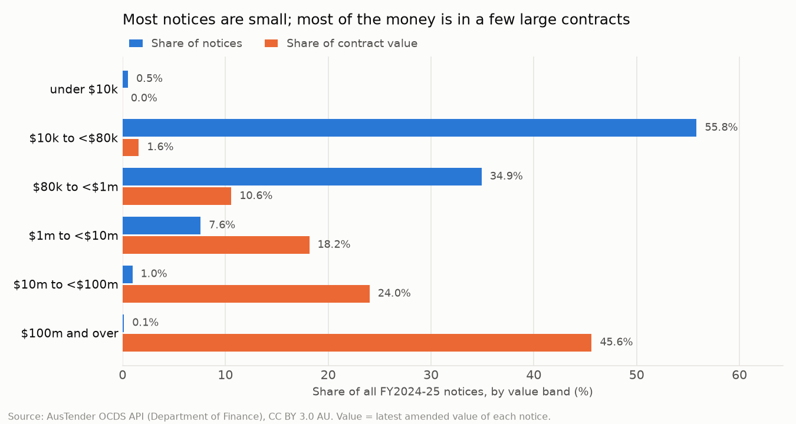
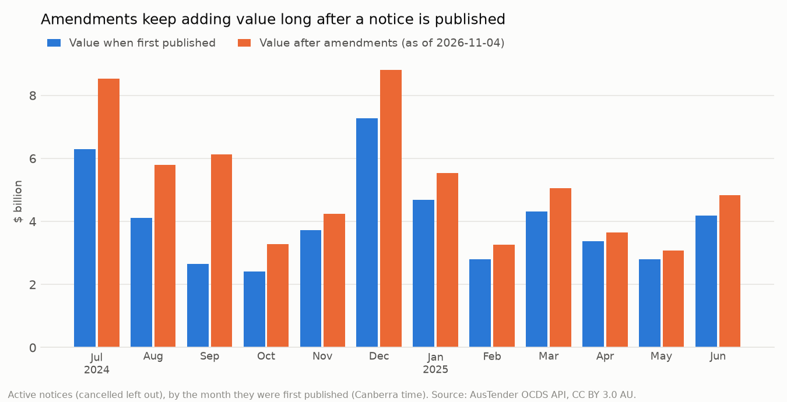

# Source profile: what the AusTender data can and can't tell us

Generated by `scripts/profile_releases.py` from `sql/profile.sql`. Every number below is
computed from `data/releases.csv.gz`; nothing is typed in by hand.

## The snapshot

| | |
|---|---|
| Source | AusTender OCDS API (`findByDates/contractPublished`), Department of Finance |
| Licence | CC BY 3.0 AU (stated in every API response; the download stops if it changes) |
| Notices covered | Contract notices first published 1 Jul 2024 to 30 Jun 2025 (Canberra time), i.e. FY2024-25 |
| Downloaded | 2026-11-04 to 2026-11-04, 365 day files, 1,292 API pages |
| Rows | 81,977 releases = 59,464 notices + 22,513 amendments |
| Agencies | 130 agency names |
| Repeats dropped | 11 releases published at exactly Canberra midnight, which the API returns for both days |

The API also returns every **later amendment** of these notices, up to the download date. The latest amendment in the snapshot was published on 4 Nov 2026. So "current value" in this project means *as of 2026-11-04*; a later download would show more.

## Traps, and the rule each one sets

| Trap | What the data shows | Rule from here on |
|---|---|---|
| **Amendment values are running totals** | Checked against the government's own export (see [`AMENDMENT_CHECK.md`](AMENDMENT_CHECK.md)): the step between two API versions equals the export's change to the cent. Summing every version gives $170.86bn, 2.6 times the $65.41bn you get from each notice's latest version. | One row per notice: its latest version. Never sum releases. |
| **Amendments are numbered, and text sorts them wrongly** | Up to 36 amendments on one notice; every one of the 22,513 amendments points at the original notice (22,513), not the amendment before it. | Order by the number after `-A`, as a number (A10 comes after A9). |
| **Value at award is not the value now** | Notices were worth $51.86bn when first published and $65.41bn after amendments (26.1% more). 2,835 of 22,513 amendments lowered the value. | Say which one a figure uses. Thresholds use the value at award. |
| **Amendment dates come in batches** | The busiest day, 8 May 2025, has 766 amendments, 95.0% from Department of Defence. | Don't read an amendment's publish date as the date it was agreed. |
| **"Limited tender" is not a red flag by itself** | 57.3% of notices are limited tenders, but 25,140 of the 34,100 (73.7%) were under $80k at award, where an open approach isn't required. 97.7% of those carry the exemption flag and no code; 572 carry a reason or exemption code anyway. | Judge limited tenders from $80k up, by their reason or exemption code. |
| **A few contracts hold most of the money** | The top 10 notices hold 21.9% of current value, the top 1% (595 notices) 68.6%. Department of Defence holds 41.8%. Median notice $60k, mean $1.1m. | Report counts and medians next to totals; show results with and without Defence. |
| **One supplier, many spellings** | 2,956 of 13,026 supplier ABNs appear under more than one name (up to 52); those ABNs hold 58.3% of value. `supplier_id` never splits an ABN (0 ABNs with more than one id). | Group suppliers by ABN, falling back to `supplier_id`. Never by name. |
| **Some suppliers have no ABN** | 4,782 notices (8.0%); 4,205 of them are overseas suppliers. Country is spelt 163 ways for 113 countries ("AUSTRALIA" and "Australia"). | Use `supplier_id` for these; upper-case the country. |
| **Agencies change names, and some have no ABN** | 120 agency ABNs carry 124 names, for example after a machinery-of-government change (Health and Aged Care became Health, Disability and Ageing in May 2025, and notices amended later carry the new name). 6 agencies have no ABN. | Group agencies by ABN, labelled with the latest name; by name where there's no ABN. |
| **Cancelled notices can come back under a new number** | 1,272 notices are cancelled ($3.20bn). 88 of 530 lookalike groups include one, among them a $2.34bn Home Affairs contract published twice, the first copy since cancelled. Summing all notices would count it twice. | Leave cancelled notices out of spend. |
| **Categories are often coded coarsely** | 57.4% of notices (60.3% of value) are coded only to a UNSPSC segment or family. | Compare categories at family level (4 digits) or above. |
| **Some start dates are placeholders** | 213 notices start before 2000 (207 on 1 Jan 1900). | Exclude them from any reporting-lag figure. |
| **Amendments almost never change the dates** | In all but 19 of the 13,759 amended notices, every version has the original start and end date. | Use the dates at award. The API can't show term extensions, only value changes. |

## Coverage and the amendment chain

- 59,464 notices, one OCDS id each (59,464 ocids); 13,759 (23.1%) have been amended.
- Every amended notice has its original version (0 missing) and no gaps in its amendment numbers (0 with gaps).
- The publish date is the same on every version of a notice (0 differ). AusTender puts it in the OCDS `dateSigned` field; it is not a signing date.
- Of 22,513 amendments: 19,395 raised the value, 283 left it unchanged and 2,835 lowered it. No value is negative (0) or zero (0).

Busiest days for amendments (by Canberra publish date):

| day | amendments | agencies | main_agency | main_agency_pct |
|---|---|---|---|---|
| 2025-05-08 | 766 | 12 | Department of Defence | 95.0 |
| 2025-11-14 | 652 | 10 | Department of Veterans' Affairs | 94.9 |
| 2026-07-08 | 604 | 12 | Department of Home Affairs | 90.7 |
| 2026-08-10 | 239 | 4 | Department of Veterans' Affairs | 95.4 |
| 2026-09-11 | 226 | 9 | Department of Veterans' Affairs | 76.5 |

## Value

| band | notices | current_value | share_of_value |
|---|---|---|---|
| 1. under $10k | 317 | $350k | 0.0% |
| 2. $10k to <$80k | 33,204 | $1.04bn | 1.6% |
| 3. $80k to <$1m | 20,771 | $6.92bn | 10.6% |
| 4. $1m to <$10m | 4,515 | $11.88bn | 18.2% |
| 5. $10m to <$100m | 573 | $15.72bn | 24.0% |
| 6. $100m and over | 84 | $29.85bn | 45.6% |

33,521 notices (56.4%) are under $80k and hold 1.6% of value; the 84 of $100m and over hold 45.6%. 317 notices are under the $10k reporting threshold (agencies may publish below it).

The ten largest notices by current value:

| cn_id | agency | supplier_name | description | original_value_aud | value_aud | n_amendments | method_details |
|---|---|---|---|---|---|---|---|
| CN4095604 | Department of Defence | VENTIA AUSTRALIA PTY LTD GEMS PROJECT | Base Services | $645.2m | $3.39bn | 9 | Open tender |
| CN4111722 | Department of Home Affairs | SECURE JOURNEYS PTY LTD | Provision of Facilities and Detainee Services | $2.34bn | $2.34bn | 0 | Open tender |
| CN4111897 | Department of Home Affairs | SECURE JOURNEYS PTY LTD | Provision of Facilities and Detainee Services | $2.34bn | $2.34bn | 0 | Open tender |
| CN4120758 | Department of Defence | MSS SECURITY PTY LIMITED GEMS PROJECT | Base Services | $1.19bn | $1.17bn | 6 | Open tender |
| CN4109017 | Department of Defence | CEA TECHNOLOGIES PTY LTD | Communication Devices and Services | $1.03bn | $1.03bn | 0 | Limited tender |
| CN4121359 | Department of Defence | RIVERINA REDEVELOPMENT JOINT VENTUR SPOTLESS FACILITY SERVICES PTY LTD | Redevelopment Project Support Services | $921.4m | $920.4m | 1 | Limited tender |
| CN4077146 | Department of Defence | BOEING DEFENCE AUSTRALIA LTD | Aircraft Sustainment | $259.4m | $879.0m | 4 | Limited tender |
| CN4103848 | Department of Home Affairs | HEALTHCARE AUSTRALIA PTY LTD | Onshore Immigration Detention Health & Wellbeing | $866.3m | $866.3m | 0 | Open tender |
| CN4138426 | Department of Health and Aged Care | Evolve FM Pty Ltd - Trust Account | Lease Rental Costs for Central Office (replacing CN99336 - A3) | $785.6m | $785.6m | 0 | Open tender |
| CN4085822 | Department of Health, Disability and Ageing | Accenture Australia Pty Ltd | Transformation Delivery | $289.4m | $591.5m | 2 | Open tender |

## Procurement method and limited-tender coding

| method | method_details | notices | current_value | notices_80k_plus |
|---|---|---|---|---|
| limited | Limited tender | 34,100 | $23.55bn | 9,394 |
| open | Open tender | 25,316 | $41.80bn | 16,526 |
| selective | Prequalified tender | 48 | $62.4m | 23 |

How limited tenders are coded, split at $80k on the value at award. The method and codes changed between first and latest version in 7 of 13,759 amended notices. Of 8,960 limited tenders of $80k and over, 4,866 give a limited-tender reason (CPRs 10.3, flag 0) and 3,955 an exemption (CPRs Appendix A or paragraph 2.6, flag 1); 139 give neither. Of 25,140 under $80k, 24,568 (97.7%) have the flag set to 1 and no code, which reads as "below the threshold, Division 2 doesn't apply".

| exemption_flag | has_reason_code | has_exemption_code | award_80k_plus | notices | current_value |
|---|---|---|---|---|---|
| 1 | False | False | False | 24,568 | $705.8m |
| 0 | True | False | True | 4,866 | $7.70bn |
| 1 | False | True | True | 3,955 | $14.81bn |
| 0 | True | False | False | 381 | $297.1m |
| 1 | False | True | False | 191 | $35.2m |
| 1 | False | False | True | 139 | $2.2m |

Reason and exemption codes used (latest version of each notice):

| kind | code | meaning | notices | current_value |
|---|---|---|---|---|
| reason | TR | 10.3.d.iii. Supply by particular business: due to an absence of competition for technical  | 2,105 | $2.39bn |
| reason | AD | 10.3.e. Additional deliveries by original supplier intended as replacement parts, extensio | 2,035 | $4.33bn |
| reason | ER | 10.3.d.ii. Supply by particular business: with no reasonable alternative or substitute: to | 396 | $424.1m |
| reason | EV | Estimated value was under the procurement threshold. | 210 | $37.0m |
| reason | EU | 10.3.b. Extreme urgency or events unforeseen. | 100 | $405.6m |
| reason | CT | Valued below the construction threshold. | 96 | $108.0m |
| reason | VM | 10.3.a.i. No submissions or value for money submissions received. | 86 | $77.5m |
| reason | CP | 10.3.a.iii. No tenderers satisfied conditions for participation. | 72 | $16.9m |
| reason | PT | 10.3.g. Prototype intended for limited trial or developed at the entity's request for a re | 69 | $87.4m |
| reason | AC | 10.3.c. Advantageous conditions arising only in the very short term, not routine procureme | 34 | $91.0m |
| reason | WA | 10.3.d.i. Supply by a particular business: for works of art. | 17 | $5.1m |
| reason | CM | 10.3.f. In a commodity market. | 16 | $21.4m |
| reason | CF | 10.3.a.ii. No submissions met minimum content and format requirements. | 10 | $5.3m |
| reason | DC | 10.3.h. Awarded to the winner of a design contest independently judged and run consistent  | 1 | $1.0m |
| exemption | AM | Paragraph 2.6 was applied in some part. | 891 | $8.46bn |
| exemption | GE | App A: 2. From another Commonwealth, state, territory or local government entity. | 523 | $1.75bn |
| exemption | OA | App A: 8. Procuring outside Australian territory for consumption outside Australian territ | 465 | $328.7m |
| exemption | LP | App A: 1. Leasing of immovable property or any associated rights. | 458 | $2.01bn |
| exemption | IS | App A: 16. SME with at least 50 percent Indigenous ownership. | 334 | $832.0m |
| exemption | PC | APP A: 17. SME Procurements up to $500,000. | 330 | $78.8m |
| exemption | RD | App A: 6. Research and development services (but not inputs). | 280 | $324.1m |
| exemption | DI | App A: 13. By, or on behalf of select Defence intelligence agencies. | 270 | $667.6m |
| exemption | LH | App A: 14. Contracts for labour hire. | 196 | $82.0m |
| exemption | GA | App A: 12. Government advertising services. | 129 | $87.7m |
| exemption | EN | App A: 7. Expert or neutral person (including counsel or barristers). | 111 | $22.1m |
| exemption | FA | App A: 5. Direct purpose of providing foreign assistance. | 110 | $174.5m |
| exemption | FD | App A: 9. Fiscal agency, depository and other associated services. | 16 | $25.4m |
| exemption | DE | App A: 15. From a business that primarily exists to provide the services of persons with a | 14 | $2.7m |
| exemption | IG | App A: 3. Funded by international grants, loans or other assistance. | 14 | $6.1m |
| exemption | GS | App A: 4. Funded by grants and sponsorship payments from non-Commonwealth entities. | 3 | $506k |
| exemption | DC | Did not comply with the CPRs. | 2 | $273k |

Status: 58,192 active, 1,272 cancelled ($3.20bn). Cancelled notices are included in this profile's totals; the spend analysis from Part 2 leaves them out.

## Suppliers and agencies

- 13,026 supplier ABNs, 16,424 supplier ids, 22,627 exact names (20,880 ignoring case).
- 146 exact names map to more than one `supplier_id`, so a name isn't a key either.
- 4,272 notices (7.2%) go to suppliers outside Australia.
- Branch is filled on 67.5% of notices and division on 75.2%. The API puts them, with the agency officer's contact details, on the *supplier* party; the snapshot keeps branch and division and drops the personal details.

Supplier ABNs with the most spellings:

| supplier_abn | names | notices | current_value | spellings |
|---|---|---|---|---|
| 47001407281 | 52 | 710 | $213.4m | HALCYON KNIGHTS COMMERCIAL AND CONTRACTING PTY LTD / HAYS OFFICE SUPPORT / HAYS PERSONNEL SERV / HAYS PERSONNE ... |
| 31010545267 | 31 | 594 | $389.7m | DATA # 3 GROUP / DATA #3 / DATA #3 LIMITED / DATA 3 GROUP / DATA 3 LIMITED / DATA 3 LTD / DATA# 3 LIMITED / DA ... |
| 69008585260 | 27 | 241 | $524.9m | JLL / JONES LANG LASALLE / JONES LANG LASALLE (ACT) / JONES LANG LASALLE (ACT) AAT TRUST / JONES LANG LASALLE  ... |
| 69405937639 | 25 | 454 | $107.4m | AGS / AGS - AUSTRALIAN GOVERNMENT SOLICITOR / AGS - Canberra / AUS GOV SOLICITOR(CENTRAL ACCOUNT) / AUST GOVER ... |
| 19002966001 | 24 | 317 | $328.4m | MEDIABRANDS AUSTRALIA / MEDIABRANDS AUSTRALIA PTY LTD / MEDIABRANDS AUSTRALIA PTY LTD (TRADING AS UNIVERSAL MC ... |
| 57195873179 | 24 | 242 | $91.8m | AGSM @ UNSW / RAPID TECH EQUIPMENT PTY / THE UNIVERSITY OF NEW SOUTH WALES / THE UNIVERSITY OF NSW / The Unive ... |
| 69102908118 | 24 | 59 | $2.3m | ANZSOG / AUS and NZ SCHOOL OF GOVERNMENT / AUST & NEW Z/LAND SCHOOL OF GOV / AUSTRALIA & NEW ZEALAND SCHOOL OF ... |
| 21002888762 | 20 | 430 | $92.5m | HUDSON GLOBAL RESOURCES / HUDSON GLOBAL RESOURCES (AUST)  PTY LTD / HUDSON GLOBAL RESOURCES (AUST) P/L / HUDSO ... |

Agency ABNs used under more than one name:

| agency_abn | names | names_used |
|---|---|---|
| (none) | 6 | Administrative Review Tribunal / Australian Submarine Agency / Level 3 Testing Agency / National Anti-Corruption Commission / Office of the Inspector-General of Aged Care / Parliamentary Workplace Support Service |
| 28692388950 | 2 | Australian Energy Regulator / National Environmental Protection Agency |
| 47065634525 | 2 | Department of Foreign Affairs and Trade / Department of Foreign Affairs and Trade - Australian Aid Program |
| 83605426759 | 2 | Department of Health and Aged Care / Department of Health, Disability and Ageing |
| 86267354017 | 2 | Department of Infrastructure, Transport, Regional Development, Communications and the Arts / Department of Infrastructure, Transport, Regional Development, Communications, Sport and the Arts |

Largest agencies by current value:

| agency | notices | current_value | value_share |
|---|---|---|---|
| Department of Defence | 21,445 | $27.33bn | 41.8% |
| Department of Home Affairs | 1,576 | $7.77bn | 11.9% |
| Department of Health, Disability and Ageing | 1,036 | $4.45bn | 6.8% |
| Department of Veterans' Affairs | 3,572 | $3.00bn | 4.6% |
| Services Australia | 2,092 | $2.14bn | 3.3% |
| Australian Taxation Office | 838 | $1.95bn | 3.0% |
| Department of Foreign Affairs and Trade | 2,295 | $1.79bn | 2.7% |
| Department of Health and Aged Care | 1,115 | $1.47bn | 2.3% |

## Categories (UNSPSC)

538 distinct codes in 56 segments and 296 families; 0 malformed. AusTender doesn't send category names, so Part 2 adds them.

| depth | notices | current_value |
|---|---|---|
| 1. segment only | 4,767 | $2.43bn |
| 2. family | 29,367 | $37.01bn |
| 3. class | 18,839 | $21.06bn |
| 4. commodity | 6,491 | $4.91bn |

## Dates and reporting lag

- Median gap from contract start to publication: 12 days; 8,737 notices (14.7%) were published more than 42 days after the contract started, 1,123 more than a year after (placeholder start dates before 2000 left out). Part 3 looks closer.
- 8,079 notices were published before the contract started.
- Median term 259 days; 76 run over 10 years.

| band | notices | over_42d | over_42d_pct |
|---|---|---|---|
| 1. under $80k | 33,308 | 5,185 | 15.6 |
| 2. $80k to <$1m | 20,771 | 2,619 | 12.6 |
| 3. $1m and over | 5,172 | 933 | 18.0 |

## Possible duplicates

530 groups of notices share agency, supplier, value at award, start date and description under different notice numbers: 762 notices beyond the first in each group, worth $2.45bn at award. **88 of the 530 groups include a cancelled notice**: a notice cancelled and published again under a new number. Among active notices only, 442 groups remain, with 669 extra notices worth $65.9m (0.14% of active value at award). Some of those will be real repeat orders, so they're kept and flagged, not removed.

Largest groups by value beyond the first notice:

| agency | supplier | description | original_value_aud | notices | notice_ids |
|---|---|---|---|---|---|
| Department of Home Affairs | SECURE JOURNEYS PTY LTD | Provision of Facilities and Detainee Services | $2.34bn | 2 | CN4111722 (cancelled), CN4111897 (active) |
| Department of Veterans' Affairs | RYAN'S RECOVERY PARTNERS | Provision of Rehabilitation Services | $10.6m | 2 | CN4081183 (cancelled), CN4085506 (active) |
| CSIRO | Kane Constructions Pty Ltd | Animal Health Facility Refurbishment, Werribee | $8.0m | 2 | CN4077769 (active), CN4089823 (cancelled) |
| Services Australia | Ernst & Young | Labour Hire | $617k | 8 | CN4110516 (active), CN4111503 (active), CN4111508 (active), CN4111510 (active), CN4111512 (active), CN4111517 (active), CN4111519 (active), CN4120109 (active) |
| Grains Research and Development Corporation | Cesar Pty Ltd | Leading practice management of the Redlegged earth mite (RLEM) | $3.0m | 2 | CN4126457 (active), CN4127179 (cancelled) |

## What this data can't tell us

- **Money spent.** A notice records a contract's value, not payments. Spend here means *committed contract value*.
- **Why an amendment happened**, or whether it extended the term (dates don't change between versions).
- **Panels and standing offers, consultancy, confidentiality.** AusTender's website shows these, but the API doesn't send them.
- **Contracts under $10k**, which agencies don't have to publish.
- **The order of same-day amendments.** When several amendments go up on one day, the value can go down and back up between them. The highest-numbered version is taken as current.
