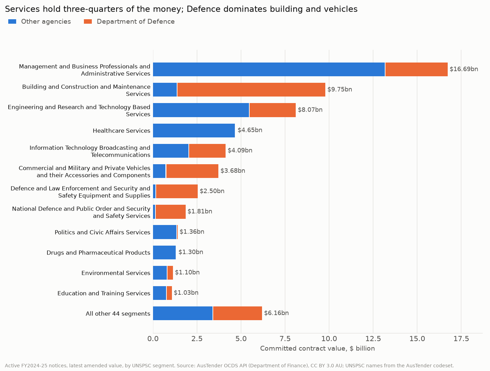
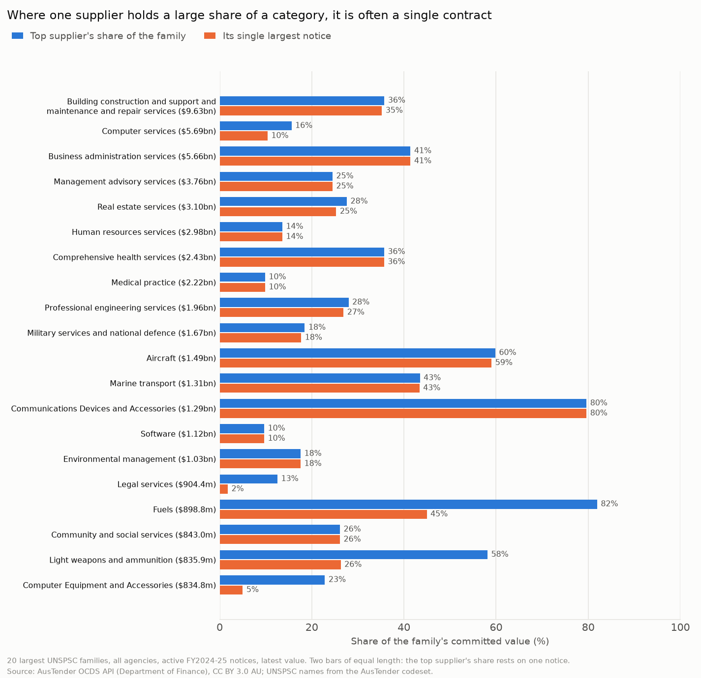

# Spend cube: where the money goes, and who it goes to

Generated by `scripts/spend_cube.py` from `sql/01_spend.sql` and `sql/spend.sql`. Every number
below is computed from `data/releases.csv.gz` and `data/unspsc_categories.csv`.

## Scope and rules

| | |
|---|---|
| Notices | 58,192 active contract notices first published in FY2024-25 (cancelled ones left out, as Part 1 decided) |
| Value | Each notice's latest amended value as of 2026-11-04: **committed contract value**, not payments. $62.21bn in total ($48.60bn at award). |
| Suppliers | 16,242, grouped by ABN; 4,670 notices have no ABN (4,107 of them with overseas suppliers) and use the API's supplier id |
| Agencies | 125, grouped by ABN and labelled with their latest name |
| Categories | The AusTender Customised UNSPSC Codeset (1 July 2023, data.gov.au, CC BY 3.0 AU): 586 codes in 320 families. All 537 codes on these notices are in it (0 missing). |
| Coarse codes | 4,672 notices ($2.39bn, 3.8% of value) are coded to a segment only. They count in segment totals but not in family tables; Part 4 tries to place them. |
| Defence | The Department of Defence holds 43.5% of value, so results are shown with and without it. Other defence bodies (e.g. ASD) are counted as other agencies. |

10 families in the codeset have codes under them but no family title of their own. Their titles were written from the codes under them and are marked `derived from child codes` in the CSV: 4621 *Workplace safety training aids*, 5610 *Furniture*, 7215 *Specialised building trade services*, 7813 *Storage and archiving services*, 8116 *Cloud services (SaaS, PaaS, IaaS)*, 8211 *Writing, translation and publicity services*, 8411 *Accounting and audit services*, 8517 *Funeral and associated services*, 8610 *Vocational rehabilitation services*, 8614 *Library or documentation services*.

## Where the money goes

| goods_services | notices | value | value_share | median_notice |
|---|---|---|---|---|
| Services | 38,395 | $47.24bn | 75.9% | $83k |
| Goods | 19,797 | $14.96bn | 24.1% | $35k |

Services hold 75.9% of committed value. The largest segment, *Management and Business Professionals and Administrative Services*, holds 26.8% on its own. Defence holds 86.1% of *Building and Construction and Maintenance Services* ($9.75bn).

Top 12 of 56 segments:

| segment | segment_title | notices | value | value_share | defence_share | median_notice |
|---|---|---|---|---|---|---|
| 80 | Management and Business Professionals and Administrative Services | 16,662 | $16.69bn | 26.8% | 21.2% | $118k |
| 72 | Building and Construction and Maintenance Services | 1,484 | $9.75bn | 15.7% | 86.1% | $119k |
| 81 | Engineering and Research and Technology Based Services | 5,599 | $8.07bn | 13.0% | 32.5% | $270k |
| 85 | Healthcare Services | 1,096 | $4.65bn | 7.5% | 0.1% | $218k |
| 43 | Information Technology Broadcasting and Telecommunications | 4,763 | $4.09bn | 6.6% | 50.5% | $72k |
| 25 | Commercial and Military and Private Vehicles and their Accessories and Components | 4,679 | $3.68bn | 5.9% | 80.5% | $33k |
| 46 | Defence and Law Enforcement and Security and Safety Equipment and Supplies | 1,643 | $2.50bn | 4.0% | 94.5% | $43k |
| 92 | National Defence and Public Order and Security and Safety Services | 617 | $1.81bn | 2.9% | 92.7% | $203k |
| 93 | Politics and Civic Affairs Services | 3,561 | $1.36bn | 2.2% | 2.6% | $50k |
| 51 | Drugs and Pharmaceutical Products | 37 | $1.30bn | 2.1% | 0.2% | $19k |
| 77 | Environmental Services | 580 | $1.10bn | 1.8% | 28.1% | $369k |
| 86 | Education and Training Services | 3,673 | $1.03bn | 1.7% | 27.3% | $23k |

The 15 largest of 288 families:

| family | family_title | notices | value | value_share | defence_share | agencies | suppliers |
|---|---|---|---|---|---|---|---|
| 7210 | Building construction and support and maintenance and repair services | 1,286 | $9.63bn | 15.5% | 86.5% | 58 | 575 |
| 8111 | Computer services | 4,656 | $5.69bn | 9.1% | 15.1% | 112 | 1,517 |
| 8016 | Business administration services | 2,126 | $5.66bn | 9.1% | 31.7% | 81 | 742 |
| 8010 | Management advisory services | 3,461 | $3.76bn | 6.0% | 37.7% | 114 | 1,423 |
| 8013 | Real estate services | 949 | $3.10bn | 5.0% | 3.5% | 57 | 794 |
| 8011 | Human resources services | 5,830 | $2.98bn | 4.8% | 1.8% | 108 | 962 |
| 8510 | Comprehensive health services | 560 | $2.43bn | 3.9% | 0.1% | 27 | 407 |
| 8512 | Medical practice | 484 | $2.22bn | 3.6% | 0.2% | 37 | 432 |
| 8110 | Professional engineering services | 367 | $1.96bn | 3.1% | 86.8% | 30 | 221 |
| 9211 | Military services and national defence | 509 | $1.67bn | 2.7% | 99.8% | 5 | 287 |
| 2513 | Aircraft | 207 | $1.49bn | 2.4% | 99.8% | 6 | 104 |
| 2511 | Marine transport | 2,227 | $1.31bn | 2.1% | 48.1% | 11 | 413 |
| 4319 | Communications Devices and Accessories | 411 | $1.29bn | 2.1% | 98.1% | 23 | 157 |
| 4612 | Missiles | 12 | $1.28bn | 2.1% | 100.0% | 1 | 6 |
| 4323 | Software | 1,680 | $1.12bn | 1.8% | 43.8% | 82 | 766 |

## Agencies

Defence holds 43.5% of value from 20,823 notices, with a median notice of $36k. The 15 largest agencies:

| agency | notices | value | value_share | median_notice | suppliers | top5_supplier_share | top_family | top_family_share |
|---|---|---|---|---|---|---|---|---|
| Department of Defence | 20,823 | $27.04bn | 43.5% | $36k | 4,923 | 31.9% | Building construction and support and maintenance and repair services | 31.2% |
| Department of Health, Disability and Ageing | 2,143 | $5.85bn | 9.4% | $224k | 699 | 47.1% | Medical practice | 32.1% |
| Department of Home Affairs | 1,562 | $5.42bn | 8.7% | $110k | 680 | 75.1% | Business administration services | 44.7% |
| Department of Foreign Affairs and Trade | 2,642 | $3.15bn | 5.1% | $67k | 1,454 | 47.2% | Management advisory services | 31.3% |
| Department of Veterans' Affairs | 3,461 | $2.80bn | 4.5% | $80k | 2,219 | 21.1% | Comprehensive health services | 45.4% |
| Services Australia | 2,087 | $2.14bn | 3.4% | $150k | 888 | 38.7% | Computer services | 43.2% |
| Australian Taxation Office | 830 | $1.95bn | 3.1% | $52k | 421 | 55.1% | Human resources services | 29.1% |
| Department of Climate Change, Energy, the Environment and Water | 2,041 | $1.42bn | 2.3% | $74k | 1,126 | 40.5% | Environmental management | 42.1% |
| Department of Employment and Workplace Relations | 949 | $1.22bn | 2.0% | $77k | 513 | 27.0% | Community and social services | 54.8% |
| Department of Finance | 988 | $981.5m | 1.6% | $103k | 543 | 49.7% | Real estate services | 30.6% |
| Department of Agriculture, Fisheries and Forestry | 1,549 | $868.6m | 1.4% | $164k | 756 | 20.8% | Human resources services | 33.9% |
| Australian Signals Directorate | 1,324 | $719.0m | 1.2% | $88k | 459 | 32.6% | Computer services | 32.1% |
| Department of Social Services | 270 | $531.4m | 0.9% | $167k | 170 | 70.0% | Community and social services | 41.6% |
| Australian Electoral Commission | 904 | $513.9m | 0.8% | $96k | 582 | 27.2% | Human resources services | 45.1% |
| Department of Infrastructure, Transport, Regional Development, Communications, Sport and the Arts | 971 | $511.8m | 0.8% | $67k | 500 | 47.8% | Real estate services | 26.1% |

`top5_supplier_share`: the share of the agency's value held by its 5 largest suppliers. `top_family`: its largest category family (segment-only notices left out).

## Suppliers

- 16,242 suppliers. **58 of them hold half the committed value** and 391 hold 80%. The top 10 hold 24.0%, the top 100 58.9%.
- 10,103 suppliers (62.2%) won exactly one notice; together they hold 20.7% of value.
- Big totals are often one contract: `largest_notice_share` below is the supplier's single largest notice as a share of its total.

| supplier | notices | value | value_share | agencies | families | names | defence_share | largest_notice_share |
|---|---|---|---|---|---|---|---|---|
| VENTIA AUSTRALIA PTY LTD | 37 | $3.44bn | 5.5% | 1 | 6 | 3 | 100.0% | 98.5% |
| SECURE JOURNEYS PTY LTD | 1 | $2.34bn | 3.8% | 1 | 1 | 1 | 0.0% | 100.0% |
| FMS ACCOUNT RESERVE BANK OF AUSTRALIA | 29 | $1.52bn | 2.5% | 1 | 13 | 1 | 100.0% | 27.2% |
| CEA TECHNOLOGIES PTY LTD | 13 | $1.36bn | 2.2% | 1 | 5 | 1 | 100.0% | 75.2% |
| MSS SECURITY PTY LTD | 8 | $1.23bn | 2.0% | 6 | 3 | 3 | 95.1% | 95.1% |
| BOEING DEFENCE AUSTRALIA LTD | 74 | $1.15bn | 1.9% | 2 | 24 | 1 | 96.5% | 76.2% |
| Accenture Australia Pty Ltd | 43 | $1.11bn | 1.8% | 13 | 10 | 4 | 12.8% | 53.2% |
| EVOLVE FM PTY LTD | 64 | $928.3m | 1.5% | 20 | 6 | 7 | 0.0% | 84.6% |
| RIVERINA REDEVELOPMENT JOINT VENTUR SPOTLESS FACILITY SERVICES PTY LTD | 2 | $925.5m | 1.5% | 1 | 2 | 1 | 100.0% | 99.4% |
| HEALTHCARE AUSTRALIA | 9 | $916.4m | 1.5% | 3 | 2 | 3 | 0.0% | 94.5% |
| GlaxoSmithKline Australia Pty Ltd | 2 | $868.3m | 1.4% | 1 | 0 | 1 | 0.0% | 50.4% |
| VIVA ENERGY AUSTRALIA PTY LTD | 48 | $737.0m | 1.2% | 2 | 2 | 2 | 100.0% | 54.8% |
| AUSTAL SHIPS PTY LTD | 36 | $640.1m | 1.0% | 2 | 11 | 2 | 11.6% | 88.4% |
| NAVANTIA AUSTRALIA PTY LTD | 73 | $552.8m | 0.9% | 1 | 4 | 1 | 100.0% | 95.2% |
| JONES LANG LASALLE (ACT) PTY LTD | 238 | $511.7m | 0.8% | 33 | 9 | 25 | 0.5% | 35.5% |

`FMS ACCOUNT RESERVE BANK OF AUSTRALIA` has no ABN and its notices are missiles, military helicopters and the like: it appears to be the account Defence uses to pay for US Foreign Military Sales, so it stands for many purchases from the US government, not one company. `names` counts the spellings used for one ABN; `families` is 0 where every notice is coded to a segment only (the vaccine supply contracts, for example).

## Supplier concentration by category

For every "large" family ($100m or more and at least 20 notices; 42 families, $55.78bn, 89.7% of value), the table gives the top supplier's share and the Herfindahl-Hirschman Index (HHI): the sum of squared supplier shares, from near 0 (many small suppliers) to 10,000 (one supplier). The bands (under 1,500 low, 1,500 to 2,500 moderate, over 2,500 high) are the ones in the 2010 US merger guidelines, used here only as a familiar scale.

One financial year of notices is lumpy: a single multi-year contract can make a category look owned by one supplier. So each family is also measured **without its single largest notice**. If the HHI then drops to 2,500 or below, the concentration is *one contract*; if it stays high, it goes *beyond one contract*.

| scope | hhi_band | driver | families | value |
|---|---|---|---|---|
| all agencies | high | beyond one contract | 6 | $4.17bn |
| all agencies | high | one contract | 4 | $2.73bn |
| all agencies | low |  | 25 | $31.41bn |
| all agencies | moderate |  | 7 | $17.47bn |
| without Defence | high | beyond one contract | 5 | $1.48bn |
| without Defence | high | one contract | 6 | $4.94bn |
| without Defence | low |  | 18 | $24.65bn |

- **All agencies:** 25 of 42 large families are low ($31.41bn), 7 moderate ($17.47bn) and 10 high. Of the high ones, 4 are one contract and 6 go beyond one contract ($4.17bn, 7.5% of large-family value).
- **Without Defence:** 29 large families: 18 low, 0 moderate, 11 high (6 one contract, 5 beyond one contract, $1.48bn).

Large families that are moderately or highly concentrated, all agencies:

| family | family_title | value | notices | agencies | suppliers | top_supplier | its notices | top supplier share | family's largest notice | HHI | HHI without largest | driver |
|---|---|---|---|---|---|---|---|---|---|---|---|---|
| 7210 | Building construction and support and maintenance and repair services | $9.63bn | 1,286 | 58 | 575 | VENTIA AUSTRALIA PTY LTD | 28 | 35.8% | 35.2% | 1,542 | 628 |  |
| 8016 | Business administration services | $5.66bn | 2,126 | 81 | 742 | SECURE JOURNEYS PTY LTD | 1 | 41.4% | 41.4% | 1,849 | 386 |  |
| 2513 | Aircraft | $1.49bn | 207 | 6 | 104 | BOEING DEFENCE AUSTRALIA LTD | 7 | 59.8% | 59.0% | 3,876 | 1,760 | one contract |
| 2511 | Marine transport | $1.31bn | 2,227 | 11 | 413 | AUSTAL SHIPS PTY LTD | 12 | 43.5% | 43.4% | 2,077 | 583 |  |
| 4319 | Communications Devices and Accessories | $1.29bn | 411 | 23 | 157 | CEA TECHNOLOGIES PTY LTD | 1 | 79.6% | 79.6% | 6,448 | 2,584 | beyond one contract |
| 1510 | Fuels | $898.8m | 114 | 9 | 50 | VIVA ENERGY AUSTRALIA PTY LTD | 28 | 81.9% | 45.0% | 6,771 | 4,702 | beyond one contract |
| 4610 | Light weapons and ammunition | $835.9m | 200 | 3 | 45 | NIOA TRADING | 44 | 58.1% | 26.3% | 3,725 | 2,501 | beyond one contract |
| 2510 | Motor vehicles | $664.2m | 1,238 | 12 | 306 | HANWHA DEFENSE AUSTRALIA PTY LTD | 1 | 55.4% | 55.4% | 3,298 | 1,172 | one contract |
| 4111 | Measuring and observing and testing instruments | $537.5m | 339 | 16 | 209 | CEA TECHNOLOGIES PTY LTD | 2 | 62.7% | 60.4% | 4,642 | 4,561 | beyond one contract |
| 8210 | Advertising | $471.4m | 420 | 51 | 66 | UNIVERSAL MCCANN | 284 | 69.1% | 17.5% | 5,098 | 7,022 | beyond one contract |
| 5510 | Printed media | $426.3m | 77 | 27 | 61 | Note Printing Australia Limited | 1 | 99.0% | 99.0% | 9,795 | 575 | one contract |
| 7810 | Mail and cargo transport | $298.3m | 356 | 49 | 119 | TOLL REMOTE LOGISTICS PTY LTD | 15 | 36.0% | 14.4% | 2,274 | 2,265 |  |
| 7818 | Transportation repair or maintenance services | $260.2m | 367 | 12 | 131 | BOEING DEFENCE AUSTRALIA LTD | 2 | 31.9% | 31.8% | 1,921 | 1,940 |  |
| 4322 | Data Voice or Multimedia Network Equipment or Platforms and Accessories | $191.0m | 272 | 33 | 96 | MANTA RAY SOLUTIONS LLC | 1 | 31.3% | 31.3% | 1,518 | 1,144 |  |
| 8311 | Telecommunications media services | $147.9m | 166 | 44 | 89 | Concentrix Services Pty Ltd | 1 | 49.2% | 49.2% | 2,945 | 2,022 | one contract |
| 8413 | Insurance and retirement services | $139.0m | 67 | 38 | 23 | Comcare | 22 | 42.7% | 30.2% | 3,256 | 4,195 | beyond one contract |
| 9212 | Security and personal safety | $135.4m | 91 | 30 | 69 | MSS SECURITY PTY LTD | 5 | 44.3% | 37.7% | 2,319 | 1,031 |  |

Highly concentrated without Defence:

| family | family_title | value | notices | agencies | suppliers | top_supplier | its notices | top supplier share | family's largest notice | HHI | HHI without largest | driver |
|---|---|---|---|---|---|---|---|---|---|---|---|---|
| 8016 | Business administration services | $3.86bn | 1,091 | 80 | 435 | SECURE JOURNEYS PTY LTD | 1 | 60.6% | 60.6% | 3,893 | 1,388 | one contract |
| 2511 | Marine transport | $677.6m | 35 | 10 | 32 | AUSTAL SHIPS PTY LTD | 1 | 83.6% | 83.6% | 7,097 | 4,255 | beyond one contract |
| 5510 | Printed media | $424.8m | 59 | 26 | 47 | Note Printing Australia Limited | 1 | 99.3% | 99.3% | 9,861 | 588 | one contract |
| 8210 | Advertising | $321.1m | 375 | 50 | 58 | UNIVERSAL MCCANN | 249 | 80.3% | 16.2% | 6,472 | 5,886 | beyond one contract |
| 8110 | Professional engineering services | $258.6m | 97 | 29 | 73 | Seymour Whyte Constructions Pty Ltd | 1 | 64.6% | 64.6% | 4,294 | 959 | one contract |
| 7810 | Mail and cargo transport | $208.5m | 168 | 48 | 77 | Australia Post | 27 | 40.7% | 20.5% | 2,996 | 2,763 | beyond one contract |
| 4111 | Measuring and observing and testing instruments | $158.7m | 136 | 15 | 91 | Sonic Healthcare Limited | 1 | 89.9% | 89.9% | 8,080 | 611 | one contract |
| 8413 | Insurance and retirement services | $138.8m | 63 | 37 | 20 | Comcare | 22 | 42.7% | 30.3% | 3,263 | 4,208 | beyond one contract |
| 8311 | Telecommunications media services | $136.2m | 128 | 43 | 79 | Concentrix Services Pty Ltd | 1 | 53.5% | 53.5% | 3,441 | 2,688 | beyond one contract |
| 9212 | Security and personal safety | $125.0m | 70 | 29 | 53 | MSS SECURITY PTY LTD | 5 | 48.0% | 40.8% | 2,699 | 1,284 | one contract |
| 4322 | Data Voice or Multimedia Network Equipment or Platforms and Accessories | $108.0m | 176 | 32 | 62 | MANTA RAY SOLUTIONS LLC | 1 | 55.3% | 55.3% | 3,390 | 1,651 | one contract |

## Spread thin: many agencies, many suppliers

The opposite pattern: large families that at least 20 agencies buy and where it takes 30 or more suppliers to reach 80% of the value. 12 families, $19.11bn. Here a category manager's question is whether pooled demand would get better terms. The API has no panel or standing-offer flag, so some of this may already go through whole-of-government panels; it's a list to check, not a finding.

| family | family_title | value | notices | agencies | suppliers | suppliers_for_80pct | median_notice | top1_share |
|---|---|---|---|---|---|---|---|---|
| 8011 | Human resources services | $2.98bn | 5,830 | 108 | 962 | 138 | $260k | 13.6% |
| 8111 | Computer services | $5.69bn | 4,656 | 112 | 1,517 | 113 | $311k | 15.6% |
| 4323 | Software | $1.12bn | 1,680 | 82 | 766 | 64 | $73k | 9.7% |
| 9313 | Humanitarian aid and relief | $467.6m | 842 | 69 | 337 | 63 | $128k | 7.3% |
| 8014 | Marketing and distribution | $228.3m | 1,028 | 77 | 707 | 50 | $28k | 17.0% |
| 8010 | Management advisory services | $3.76bn | 3,461 | 114 | 1,423 | 46 | $115k | 24.5% |
| 7811 | Passenger transport | $175.2m | 482 | 38 | 296 | 44 | $100k | 18.9% |
| 4617 | Security surveillance and detection | $106.2m | 444 | 47 | 236 | 41 | $46k | 9.4% |
| 9314 | Community and social services | $843.0m | 2,022 | 40 | 1,205 | 40 | $50k | 26.1% |
| 7710 | Environmental management | $1.03bn | 478 | 21 | 292 | 37 | $522k | 17.6% |
| 8510 | Comprehensive health services | $2.43bn | 560 | 27 | 407 | 37 | $246k | 35.7% |
| 8116 | Cloud services (SaaS, PaaS, IaaS) | $287.8m | 325 | 77 | 201 | 34 | $158k | 14.0% |

## Files

- `spend_cube.csv`: agency x segment x family x goods/services, with notices, suppliers, committed value and value at award (3,614 rows; it adds up to the totals above). Ready to load into Power BI or a spreadsheet pivot.
- `family_concentration.csv` and `family_concentration_ex_defence.csv`: every family, not just the large ones.
- `top_suppliers.csv` (top 200) and `agency_spend.csv` (all agencies).

## Limits

- **Committed value, not payments.** A notice records what a contract is worth over its life, and multi-year contracts are booked in the year their notice was published.
- **Concentration is the buyer's view.** It shows how much of the government's own spend goes to a few suppliers, not market share in the economy.
- **Codes are the agency's choice.** A contract can sit in an unexpected family (Part 4 looks at coding quality), and segment-only notices are missing from the family tables.
- **No panel flag** in the API, so a repeat winner may be the supplier of a central arrangement chosen through open competition.
